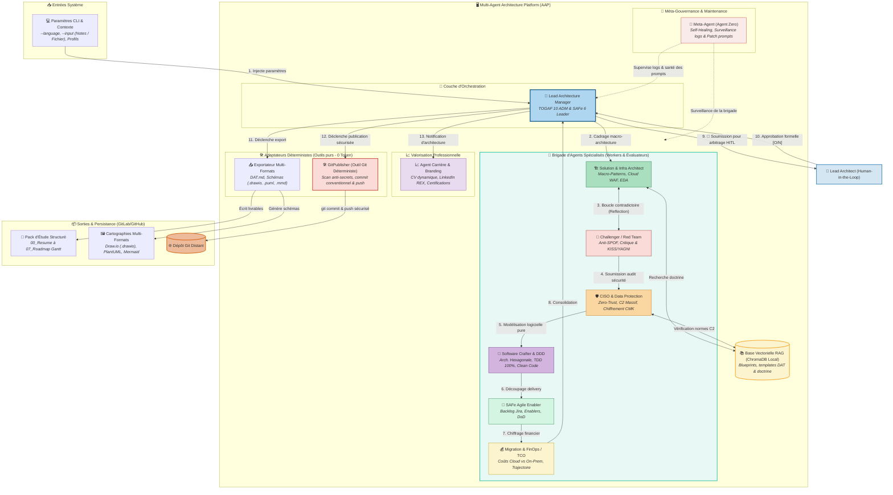

# Target Architecture Dossier: Multi-Agent Architecture Platform (AAP)

**Auteur :** Lead Enterprise & Solution Architect (Software Crafter)  
**Méta-Cadre Référentiel :** TOGAF 10 ADM (Phases A à G), SAFe 6 for Architects, Cloud Well-Architected Framework (WAF), Zero-Trust (NIST SP 800-207), Architecture Hexagonale / DDD, Gouvernance IA (NIST AI RMF / ISO 42001) & Agentic Design Patterns  
**Version :** 2.0 — Alignement exhaustif Brigade d'Agents & Adaptateur GitPublisher  
**Date :** Octobre 2026  

---

## Preliminary Phase: Principles & Framework

### 1. Principes d'Ingénierie Directeurs
1. **Architecture as Code (AaC)** : Tout livrable est versionné sous forme de texte brut éditable (Markdown, PlantUML `.puml`, Mermaid `.mmd`, Draw.io `.drawio`, Python) dans Git.
2. **Human-in-the-Loop (HITL) Obligatoire & Boucle d'Arbitrage des Évolutions du TO-BE** : Aucun commit Git ni publication définitive ne s'effectue sans l'approbation explicite de l'architecte humain dans le terminal. De même, aucun agent ne peut modifier unilatéralement la cible (TO-BE) : toute proposition d'amélioration ou de simplification émise par un agent (Challenger, CISO, Crafter, FinOps) est formalisée en proposition d'amendement motivée (RFC/ADR) soumise à la confirmation expresse du Lead Architecte avant mise à jour du TO-BE et des schémas.
3. **Séparation Cognitif vs Déterministe (L'outil `GitPublisher`)** : Les agents LLM raisonnent, rédigent et critiquent l'architecture ; les opérations de système de fichiers et de versioning Git (`git add`, `git commit`, `git push`) sont déléguées à un adaptateur déterministe sécurisé (`GitPublisher`), garantissant l'absence de fuite de secrets (.env, tokens) sans gaspiller de tokens LLM.
4. **Auto-Maintenance & Résilience Logicielle (Meta-Agent)** : La plateforme surveille sa propre exécution, détecte les dérives de prompts ou les erreurs de syntaxe, et propose des correctifs sur son propre code source.
5. **Zero-Trust & Classification Stricte des Données** : Respect systématique des paliers de sensibilité (C0, C1, C2, C2 massif, RGPD), du chiffrement de bout en bout (CMK/HSM) et instruction formelle des Dossiers de Conformité Architecture (DCA).
6. **Doctrine Multi-Référentiels Intégrée** : TOGAF 10 structure la démarche macro, SAFe 6 organise le delivery agile, le Cloud WAF optimise les infrastructures, l'Architecture Hexagonale/DDD assainit le code, et les Agentic Patterns orchestrent l'IA.

---

## Phase A: Architecture Vision & Inputs

- **Objectif Majeur :** Transformer des expressions de besoin ou notes de cadrage brutes en dossiers d'architecture complets (DAT), cartographies C4 multi-formats, avis de conformité sécurité, micro-patterns de code et backlogs Jira immédiatement prêts pour les équipes de développement.
- **Entrées du Système (System Inputs) :**
  - **Langue cible (`--language`)** : Définit la langue stricte de restitution des livrables (ex : `French`, `English`, `Spanish`).
  - **Expression de besoin (`--input`)** : Notes brutes de réunion, spécifications métier ou exigences techniques.
  - **Fichier de sortie optionnel (`--output`)** : Emplacement cible pour le livrable Markdown principal.
  - **Paramètres de profil professionnel** : Objectifs de certifications cibles et axes de veille pour l'agent carrière.

---

## Phase B: Business Architecture (Process Workflow)

Le cycle de traitement orchestré par le **Lead Architecture Manager** suit une séquence rigoureuse en 11 étapes :

```
[1. Cadrage TOGAF Phase A] (Manager)
        │
[2. Macro-Patterns Cloud/EDA] (Solution Architect + RAG)
        │
[3. Boucle Reflection & Critique] ◄──► [Challenger / Red Team] (Anti-SPOF / Anti-Sur-ingénierie)
        │
[4. Audit Sécurité & DCA] (CISO & Data Protection) (Zero-Trust, C2, Chiffrement)
        │
[5. Micro-Patterns & Clean Code] (Software Crafter) (Arch. Hexagonale, DDD, TDD 100%)
        │
[6. Découpage Delivery Agile] (SAFe Agile Enabler) (Enabler Epics, Stories Jira, DoD)
        │
[7. Chiffrage & Trajectoire] (Migration & FinOps) (TCO Cloud vs On-Premise)
        │
[8. 🛑 Human-in-the-Loop] ◄──► [Lead Architect Humain] (Arbitrage & Approbation formelle)
        │
[9. Publication Déterministe] ───► [GitPublisher (Tool)] (Scan anti-secrets, Commit & Push)
        │
[10. Valorisation Professionnelle] (Agent Carrière & Branding) (Mise à jour CV, post LinkedIn)
        │
[11. Observabilité & Self-Healing] (Meta-Agent / Agent Zero) (Surveillance logs & patch code)
```

1. **Cadrage préliminaire (Phase A TOGAF)** : Le Manager analyse le besoin brut, formalise la vision stratégique et initialise la session.
2. **Conception des Macro-Patterns** : Le Solution Architect élabore l'architecture système (Cloud WAF, EDA/Kafka, Outbox, Strangler Fig, Circuit Breakers) en interrogeant la base de connaissances (RAG ChromaDB).
3. **Boucle contradictoire (Reflection & Critique)** : Le Challenger (Red Team) traque la sur-ingénierie (*Golden Hammer*), les SPOF et impose la simplification (KISS/YAGNI).
4. **Audit de Sécurité & Homologation DCA** : Le CISO évalue la classification des données (C1, C2, C2 massif, RGPD), le chiffrement (au repos/en transit) et rend un avis formel pour le Dossier de Conformité Architecture.
5. **Modélisation des Micro-Patterns Logiciels** : Le Software Crafter traduit l'architecture en composants purs : Architecture Hexagonale (Ports & Adapters), modélisation DDD (Aggregates, Bounded Contexts) et stratégie de testabilité unitaire 100% TDD.
6. **Passage au Delivery Agile (SAFe ART)** : Le SAFe Agile Enabler découpe la solution en Enabler Epics, Features et User Stories techniques pour Jira, avec critères d'acceptation et Definition of Done (DoD).
7. **Estimation Économique & Transition (FinOps)** : L'agent FinOps chiffre le TCO comparatif (On-premise vs Cloud IaaS/PaaS/SaaS) et définit les jalons de bascule progressive.
8. **🛑 Porte de validation Human-in-the-Loop (HITL)** : Le système suspend son exécution et soumet la synthèse consolidée à l'arbitrage formel de l'architecte en chef dans la console CLI.
9. **Exportation & Versioning Déterministe (`GitPublisher`)** : Après validation humaine, l'outil `GitPublisher` formate les livrables (`DAT.md`, schémas C4), contrôle l'absence de secrets sensibles, génère un commit conventionnel et pousse sur le dépôt distant.
10. **Valorisation Professionnelle & Branding** : L'Agent Carrière met à jour le CV de l'architecte avec les technologies mises en œuvre, rédige un brouillon de post LinkedIn (REX) et cartographie les compétences acquises vers les certifications cibles.
11. **Méta-Gouvernance & Maintenance (Meta-Agent)** : En tâche de fond, le Meta-Agent (Agent Zero) inspecte les logs d'exécution, détecte les anomalies ou hallucinations de tokens, et affine les invites système (`prompts`) de la flotte.

---

## Phase C: Information Systems Architecture (IS)

### 1. Cartographie Complète de la Brigade d'Agents & Adaptateurs (Mermaid)



*(Note : Les fichiers sources éditables complémentaires sous format **Draw.io (`.drawio`)** et **PlantUML (`.puml`)** sont disponibles dans le dossier `docs/diagrams/`).*

### 2. Matrice Rôles & Responsabilités de la Flotte des 24 Agents (3 Collèges)

#### Collège 1 : Brigade Opérationnelle TOGAF, SAFe & AVV (10 Agents)
| Rôle Agent | Type | Framework d'Appartenance | Responsabilité Majeure |
| :--- | :--- | :--- | :--- |
| **Lead Architecture Manager** | Orchestrateur | TOGAF 10 ADM & SAFe 6 | Réceptionne les consignes, pilote le workflow séquentiel/hiérarchique, consolide le DAT final. |
| **Solution & Infrastructure Architect** | Constructif (Macro) | Cloud WAF & Reactive Architecture | Macro-patterns système (Cloud, Kafka EDA, Outbox, Strangler, Circuit Breakers). |
| **Challenger / Red Team** | Évaluateur | Heuristiques SRE, KISS & YAGNI | Critique contradictoire, traque de la sur-ingénierie (*Golden Hammer*), détection des SPOF. |
| **CISO & Data Protection** | Évaluateur / Garde | Zero-Trust (NIST) & RGPD | Classification des données (C1, C2, C2 massif), chiffrement CMK, avis d'homologation DCA. |
| **Software Crafter & Domain Architect**| Constructif (Micro) | Hexagonal, DDD & Clean Code | Architecture Hexagonale (Ports & Adapters), modélisation du domaine, testabilité TDD 100%. |
| **SAFe Agile Delivery Enabler** | Constructif (Delivery)| SAFe 6 for Architects | Découpage vertical en Enabler Epics, Features, User Stories Jira avec Definition of Done (DoD). |
| **Agent Migration & FinOps / TCO** | Spécialiste | FinOps Foundation & Cloud Economics | Chiffrage TCO comparatif (Cloud vs On-premise), ROI et trajectoire de bascule progressive. |
| **Meta-Agent (Agent Zero)** | Méta-Supervision | NIST AI RMF & Self-Healing | Observabilité des logs, détection des dérives d'agents, affinage dynamique des prompts et correctifs code. |
| **Agent Carrière & Personal Branding** | Valorisation Humaine | Career Management & Certifications | Mise à jour du CV, brouillons de posts LinkedIn (REX) et veille certifications (TOGAF, SAFe, Cloud). |
| **Presales & Bid Director** | Constructif (Avant-Vente) | Stratégie d'Offre & RFP | Cadrage des réponses aux appels d'offres (AVV), matrice Entrants/Sortants, co-construction et dérisquage MVP. |

#### Collège 2 : Le Comité d'Architecture Virtuel des 5 Maîtres & Green/FinOps (7 Agents)
| Rôle Agent | Doctrine / Spécialité | Responsabilité Majeure |
| :--- | :--- | :--- |
| **Martin Fowler** | Enterprise Patterns & Evolutionary Archi | Évolutivité, patterns d'intégration d'entreprise et refactoring pragmatique. |
| **Robert C. Martin (Uncle Bob)** | Clean Architecture & SOLID | Étanchéité absolue du domaine métier, découplage des frameworks et Software Craftsmanship. |
| **Werner Vogels** | Cloud Resilience & Design for Failure | Résilience multi-zones (« Everything fails all the time »), anti-SPOF et découplage asynchrone. |
| **Alistair Cockburn** | Ports & Adapters (Hexagonale) | Isolation driving/driven, bouchons de testabilité unitaire déterministes à 0 token. |
| **Sam Newman** | Monolith to Microservices & DDD | Décomposition des domaines, isolation des données transactionnelles et Loi de Conway. |
| **GreenOps & FinOps Architect** | Éco-Conception & Cloud Economics | Réduction carbone (gCO2eq), modélisation TCO et Right-Sizing capacitaire. |
| **Architecture Quality Gate Judge** | Arbitrage Qualité & Scoring | Scoring formel sur 100, verdict binaire et pilotage du rebouclage d'auto-correction. |

#### Collège 3 : Le Conseil des 5 Grands Orateurs & Restitution TEDx (7 Agents)
| Rôle Agent | Signature Oratoire | Responsabilité Majeure |
| :--- | :--- | :--- |
| **Hassan II** | Éloquence Royale & Hauteur de Vue | Noblesse métaphorique, silences habités de 3 secondes, intonation descendante souveraine. |
| **Steve Jobs** | Storytelling Épuré & Rule of Three | Dramatisation du problème (Hero vs Villain), règle de trois et formule One More Thing. |
| **Martin Luther King Jr.** | Émotion Profonde (Pathos) & Anaphore | Rythme ternaire anaphorique, élévation morale et vision collective mobilisatrice. |
| **Winston Churchill** | Formules Martiales & Concision | Verbes d'action au présent, détermination sans faille face aux contraintes critiques. |
| **Barack Obama** | Cadence Respiratoire & Empathie | Respiration diaphragmatique, modulation des pauses [BREATHE] et connexion humaine. |
| **Executive Stage Director** | Mise en Scène Exécutive | Fusion unifiée du draft de discours en prompter scénarisé avec repères mot-à-mot. |
| **Supreme Eloquence Judge** | Arbitrage d'Éloquence | Évaluation de la soutenance sur 5 axes et pilotage du rebouclage d'impact. |

#### Adaptateurs Déterministes & Architectural Fitness Functions (12 Outils Purs)
- **`GitPublisher`** : Contrôle anti-secrets (.env), formatage Conventional Commits, publication sécurisée HITL.
- **`JiraBacklogExporter`** : Parsing Markdown et export CSV conforme Excel FR (délimiteur point-virgule `;`).
- **`DiagramExporter`** : Modélisation triple format simultané (Draw.io XML, PlantUML sans !include, Mermaid).
- **`ExecutivePresentationExporter`** : Déploiement de decks HTML 16:9 Haute Couture Bento Grid avec typographie adaptative `clamp()`.
- **`ExecutivePrompterExporter`** : Téléprompteur interactif Single-Slide et script Markdown minuté.
- **`AsIsRealityLinter`** : Détection et blocage de toute hallucination de Cloud prématuré dans l'existant (AS-IS).
- **`BidComplianceGate`** : Audit de conformité des réponses d'avant-vente (DAG, ADR, DAT, PCA, Entrants/Sortants, Co-construction).
- **`ZeroTofuViewportGate`** : Détection des glyphes Unicode tofu (`□□□`) et verrouillage vertical viewport (`min(94vh)`).
- **`KnowledgeSearchTool` & `ArchitectureRAGManager`** : Indexation et recherche vectorielle ChromaDB locale.
- **`CareerExporter` & `LogAnalyzer`** : Observabilité des traces et valorisation de carrière.

---

## Phase D: Technology Architecture

- **Moteurs d'Inférence LLM :**
  - `Google Gemini 3.8 Flash` : Agents ouvriers et évaluateurs (Solution, Challenger, CISO, Crafter, SAFe, FinOps, Manager) pour une latence ultra-faible, une fidélité maximale et un coût optimisé.
- **Moteur Vectoriel & RAG :** `ChromaDB` en mode local persistant (`chroma_db/`), indexant les blueprints et la doctrine d'entreprise (`knowledge/`).
- **Framework d'Agents :** Python 3.13+, `CrewAI` (Orchestration séquentielle et hiérarchique avec `output_log_file` natif).
- **Outillage & Publication :**
  - `KnowledgeSearchTool` : Outil de recherche vectorielle locale RAG injecté dans Solution Architect et CISO.
  - `GitPublisher` : Module Python interne avec wrapper `git CLI` et vérification de conformité `.gitignore` / `.aiexclude`.
  - Moteur de rendu graphique : PlantUML CLI / Plantuml.com REST API, Mermaid CLI, Draw.io XML format.
  - Générateur de présentations : Marp CLI (Markdown to PPT/PDF).

---

## Phase E: Opportunities and Migration Plan

La feuille de route d'implémentation est découpée en 5 briques incrémentales :

* **Brique 1 : Socle Technique & Connecteur Gemini** 🟢 *(Terminé)*
  * Modularité du code, configuration multi-modèles (`settings.py`), gestion stricte multi-langue (`--language`).
* **Brique 2 : Brigade d'Agents Spécialisés d'Architecture** 🟢 *(Terminé)*
  * 2.1 CISO & Data Protection Agent (🟢 Implémenté & Testé).
  * 2.2 Software Crafter & Domain Architect Agent (🟢 Implémenté & Testé).
  * 2.3 SAFe Agile Delivery Enabler Agent (🟢 Implémenté & Testé).
  * 2.4 Challenger / Red Team Agent (🟢 Implémenté & Testé).
  * 2.5 Migration & FinOps Agent (🟢 Implémenté & Testé).
  * 2.6 Séquence complète câblée dans `src/main.py` avec export `--study-dir` multi-documents.
* **Brique 3 : Module RAG & Base de Connaissances (ChromaDB)** 🟢 *(Terminé)*
  * Répertoire de doctrine d'entreprise (`knowledge/doctrine/`) : Zero-Trust C2, Craftsmanship Hexagonal/DDD, Patrons Cloud WAF, Gouvernance SAFe.
  * Base vectorielle locale persistante (`chroma_db/`) avec `ArchitectureRAGManager`.
  * Outil CrewAI `KnowledgeSearchTool` injecté dans Solution Architect et CISO.
* **Brique 4 : Génération des Livrables & Outil GitPublisher** 🟢 *(Terminé)*
  * Génération multi-formats (`DAT.md`, `.puml`, `.mmd`, `.drawio`) via `DiagramExporter`.
  * Exportation automatique du pack multi-fichiers via `--study-dir` et export Jira CSV via `JiraBacklogExporter`.
  * Adaptateur déterministe `GitPublisher` avec scan anti-secrets et porte bloquante Human-in-the-Loop (`[O/N]`).
* **Brique 5 : Méta-Gouvernance, Personal Branding & Auto-Maintenance** 🟢 *(Terminé)*
  * 5.1 Meta-Agent (Agent Zero - Self-Healing) avec outil `LogAnalyzer` et tâche `create_meta_maintenance_task`.
  * 5.2 Agent Carrière & Personal Branding avec outil `CareerExporter` et tâche `create_career_branding_task`.

---

## Phase G: Governance & Operating Rules

1. **Règle d'or de publication Git** : Aucune commande `git push` n'est jamais exécutée sans l'autorisation explicite de l'utilisateur (`[O/N]`).
2. **Protection des Données & Anonymisation** : Aucune adresse IP interne, nom de serveur ou clé secrète n'apparaît dans les sorties générées. Tout secret détecté bloque immédiatement le `GitPublisher`.
3. **Traçabilité & Mémoire Projet** : Tout avancement significatif est consigné dans le journal de bord `docs/CONTEXTE_PROJET.md`.
