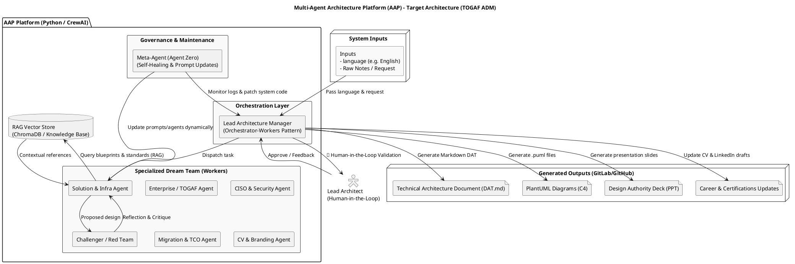

# Target Architecture Dossier: Multi-Agent Architecture Platform (AAP)

## Preliminary Phase: Principles & Framework
- **Engineering Principles:**
  1. *Architecture as Code (AaC)*: All deliverables are version-controlled as text (Markdown, PlantUML, Python) in Git.
  2. *Self-Evolution & Meta-Maintenance*: The system self-maintains via a Meta-Agent.
  3. *Human-in-the-Loop (HITL)*: Mandatory validation by the architect before any production/Git push.
  4. *Zero-Trust & Data Classification*: Strict handling of data sensitivity and secrets.

---

## Phase A: Architecture Vision & Inputs
- **Major Objective:** Automate the production of architecture deliverables, technical documentation, and career management.
- **System Inputs:**
  - **Language Selection (`input_language`)**: Defines the target language for all generated outputs (e.g., English, French).
  - Raw framing notes or meeting transcriptions.
  - Client requirements and infrastructure constraints (Cloud, Hybrid, or On-Premise).
  - Project configuration parameters and career targeting goals (certifications, profile).

---

## Phase B: Business Architecture (Process Workflow)
The sequential and iterative workflow orchestrated by the **Agent Manager**:
1. Framing and extraction of ADRs (CR Agent).
2. Strategic alignment with TOGAF / SAFe (Enterprise Agent).
3. Agnostic technical design (Solution Agent).
4. Security, encryption, and classification (CISO & Secrétaire Agent).
5. Risk and SPOF challenging (Challenger / Red Team Agent).
6. Transition planning and TCO estimation (Migration & TCO Agents).
7. 🛑 **Human-in-the-Loop (HITL)**: Review and validation by the Lead Architect.
8. C4/PlantUML modeling and Design Authority preparation (Modeling & PPT Agents).
9. Git delivery and Personal Branding / Career update (DevOps & CV/Certifications Agents).
10. Fleet governance and maintenance (Meta-Agent).

---

## Phase C: Information Systems Architecture (IS)

### 1. High-Level Architecture Diagram (PlantUML)


### 2. Agent Architecture Patterns (Agentic Design Patterns)
The system relies on industry-standard agentic design patterns:
- **Orchestrator-Workers Pattern:** The Agent Manager directs and distributes tasks to specialized agents.
- **Reflection & Critique Pattern:** The Challenger Agent audits and enforces corrections on technical proposals.
- **Human-in-the-Loop Pattern:** Human validation gates to ensure governance.
- **Self-Healing Pattern:** The Meta-Agent analyzes execution errors to patch and maintain the agent fleet.
- **Tool-Use & Action Pattern:** Utilization of native tools (file system, Git commands, CLI).
- **Retrieval-Augmented Generation (RAG) Pattern:** 
  - *Integration Purpose:* Allows agents to query internal corporate knowledge bases, previous DATs, validated infrastructure blueprints, and compliance policies stored in a dedicated vector repository.
  - *Mechanism:* Implemented as a tool for the Solution and Enterprise agents to fetch accurate contextual references before generating architecture decisions.

### 3. System Outputs
Upon each execution, the platform produces:
- **Technical Architecture Document (DAT.md)** structured (strategy, infrastructure, security, TCO, roadmap).
- **C4 / ArchiMate Diagrams & Schemas** in PlantUML source format (`/schemas/`).
- **Arbitration dossier and presentation deck** for the Design Authority.
- **Career Updates**: Updated CV, LinkedIn post drafts, and certification study plans.

---

## Phase D: Technology Architecture
- **LLM Engine:** Google Gemini API (Free Tier) + Local Ollama backup.
- **Vector Storage & RAG:** Local/Cloud Vector Database (e.g., ChromaDB / FAISS) integrated via retrieval tools.
- **Execution Stack:** Python 3.11+, CrewAI / LangGraph.
- **Toolchain:** Git (GitLab/GitHub), PlantUML CLI, Marp CLI (slides generation).

---

## Phase E: Opportunities and Migration Plan
- **Milestone 1 (MVP):** Manager, Solution Agent, Modeling, basic Git tool, and RAG retrieval tool setup.
- **Milestone 2:** Integration of Security, Challenger, TCO, and Human-in-the-Loop.
- **Milestone 3:** Addition of Meta-Agent, Personal Branding, and Certifications Watch.

---

## Phase G: Governance and User Guide

### 1. Quick Installation
```bash
git clone https://github.com/your-account/my-agentic-architecture.git
cd my-agentic-architecture
pip install -r requirements.txt
```

### 2. Key Configuration
Set your Gemini API key in your environment:
```bash
export GEMINI_API_KEY="your_api_key"
```

### 3. System Execution
Launch the main orchestrator specifying the target language and input notes:
```bash
python src/main.py --language "English" --input "Path to raw framing notes or request"
```
