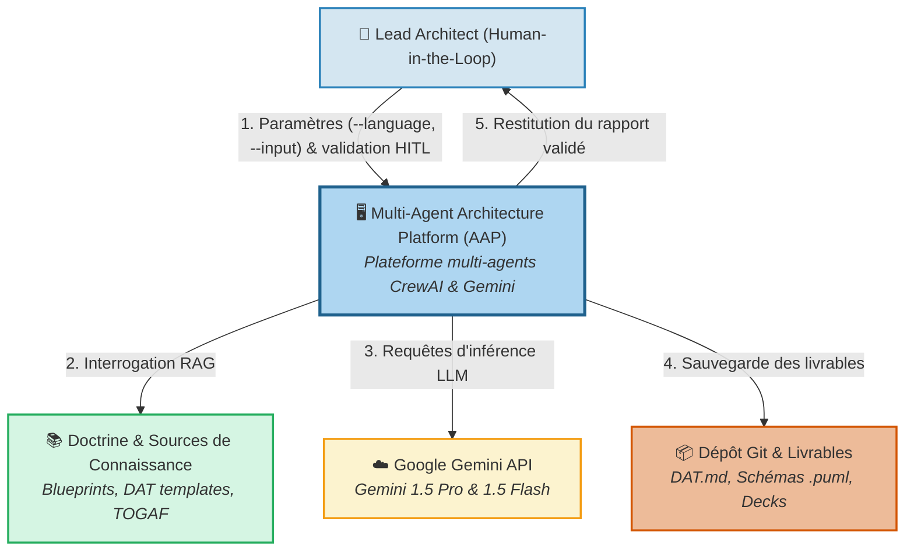
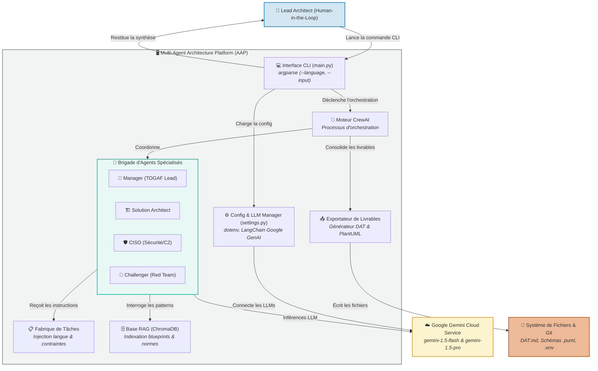
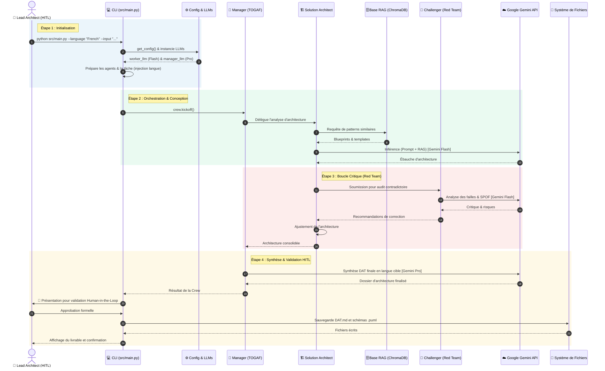

# Cartographie d'Architecture du Projet : Multi-Agent Architecture Platform (AAP)

Ce répertoire regroupe les diagrammes d'architecture du projet, déclinés en **PlantUML (`.puml`)** pour les rendus formels et en **Mermaid (`.mmd`)** pour la visualisation native dans GitHub et vos documents Markdown.

---

## 1. C4 Model — Niveau 1 : Contexte Système

Ce diagramme positionne la plateforme dans son environnement direct, avec ses utilisateurs et ses dépendances externes.

### Visualisation Mermaid :

* **Fichier PlantUML source :** [`c4_level1_system_context.puml`](./c4_level1_system_context.puml)
* **Fichier Mermaid source :** [`c4_level1_system_context.mmd`](./c4_level1_system_context.mmd)
* **Fichier Draw.io natif :** [`c4_level1_system_context.drawio`](./c4_level1_system_context.drawio)

---

## 2. C4 Model — Niveau 2 : Conteneurs Applicatifs

Ce diagramme détaille les briques logicielles internes de la plateforme Python (CLI, Configuration, Orchestrateur, Agents, RAG et Exportateurs).

### Visualisation Mermaid :

* **Fichier PlantUML source :** [`c4_level2_container.puml`](./c4_level2_container.puml)
* **Fichier Mermaid source :** [`c4_level2_container.mmd`](./c4_level2_container.mmd)
* **Fichier Draw.io natif :** [`c4_level2_container.drawio`](./c4_level2_container.drawio)

---

## 3. Diagramme de Séquence : Workflow d'Exécution & Reflection Loop

Ce diagramme illustre le flux séquentiel des échanges, de la commande utilisateur jusqu'à la boucle contradictoire avec le Challenger et l'export des fichiers.

### Visualisation Mermaid :

* **Fichier PlantUML source :** [`sequence_architecture_workflow.puml`](./sequence_architecture_workflow.puml)
* **Fichier Mermaid source :** [`sequence_architecture_workflow.mmd`](./sequence_architecture_workflow.mmd)
