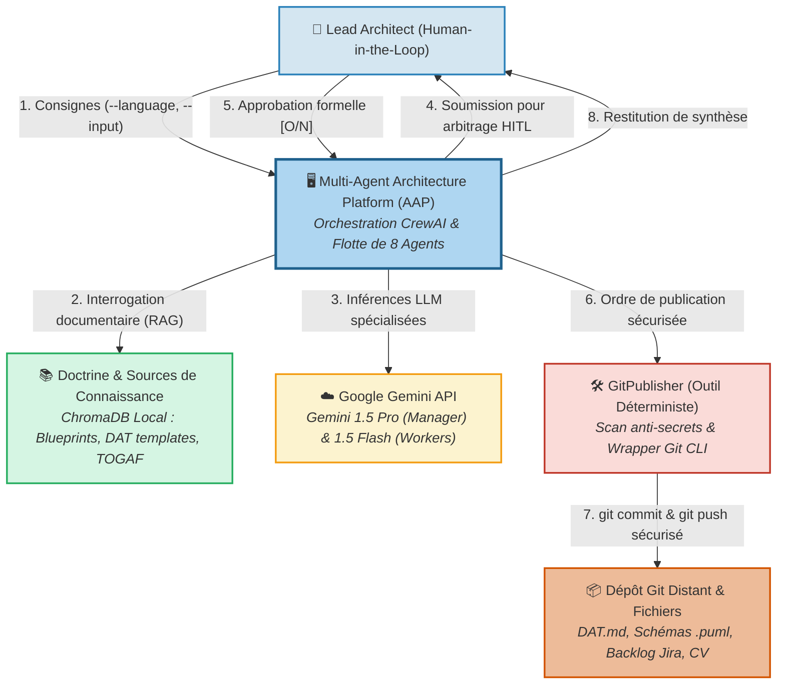
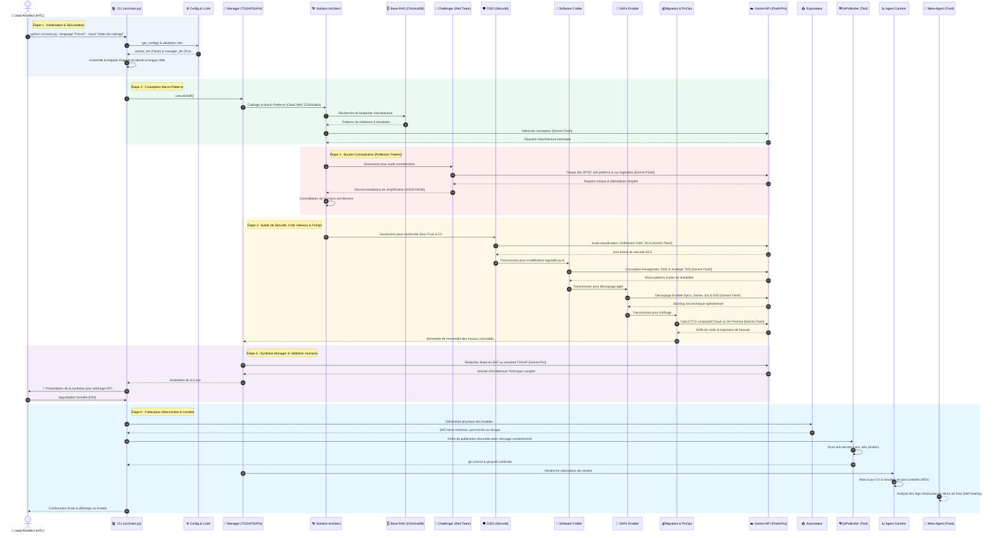

# Dossier d'Architecture Visuelle & Fonctionnelle
## Multi-Agent Architecture Platform (AAP)

**Auteur :** Lead Enterprise & Solution Architect (Software Crafter)  
**Méta-Cadre Référentiel :** TOGAF 10 ADM (Phases A à G), SAFe 6 for Architects, Cloud Well-Architected (WAF), Zero-Trust (NIST SP 800-207), Architecture Hexagonale / DDD, Gouvernance IA (NIST AI RMF / ISO 42001), Classification C2 & Agentic Patterns  
**Version :** 2.0 — Alignement exhaustif de la Brigade d'Agents & Adaptateur GitPublisher  
**Date :** Octobre 2026  

---

## 📖 Guide de Lecture
Ce document constitue la **Living Documentation** du projet : il détaille l'articulation de l'ensemble de la flotte d'agents spécialisés, des adaptateurs déterministes et des processus de gouvernance.

Tous les diagrammes s'affichent automatiquement en Markdown dans GitHub et VS Code (`Ctrl + Shift + V`). Les fichiers sources éditables (**Draw.io**, **PlantUML** et **Mermaid**) sont disponibles dans le dossier `docs/diagrams/`.

---

## 0. Le Méta-Cadre Global Multi-Référentiels (Architecture Doctrine)

Dans un environnement d'entreprise moderne, aucun cadre unique ne peut couvrir l'ensemble des dimensions d'une architecture résiliente. La plateforme **AAP** adopte une approche hybride où **TOGAF 10 fournit le squelette méthodologique**, enrichi par **6 référentiels d'ingénierie et de gouvernance spécialisés**.

```
                           ┌───────────────────────────────────────────────┐
                           │          LEAD ARCHITECT (Humain)              │
                           │   Arbitrage & Décision (Human-in-the-Loop)    │
                           └───────────────────────▲───────────────────────┘
                                                   │
    ┌──────────────────────────────────────────────┴──────────────────────────────────────────────┐
    │                                  AGENT MANAGER (Orchestrateur)                              │
    │  • Méthode & Gouvernance : TOGAF 10 ADM (Phases A à G) + SAFe 6 for Architects             │
    │  • Éthique & Risques IA  : NIST AI RMF + ISO/IEC 42001 + EU AI Act (Transparence/Audits)    │
    └──────┬───────────────────────┬───────────────────────┬───────────────────────┬──────────────┘
           │                       │                       │                       │
┌──────────▼──────────┐ ┌──────────▼──────────┐ ┌──────────▼──────────┐ ┌──────────▼──────────┐
│ SOLUTION ARCHITECT  │ │   CISO / SÉCURITÉ   │ │   SOFTWARE CRAFTER  │ │  SAFE SYSTEM ARCH   │
│ (Macro-Patterns)    │ │ (Sécurité & C2)     │ │ (Micro-Patterns)    │ │ (Agile Delivery)    │
│ • Cloud WAF         │ │ • Zero-Trust (NIST) │ │ • Arch. Hexagonale  │ │ • Enabler Epics     │
│ • EDA / Kafka       │ │ • Classif. C2 massif│ │ • Domain Design DDD │ │ • Features & Stories│
│ • Outbox & Strangler│ │ • Chiffrement (CMK) │ │ • TDD & Clean Code  │ │ • Backlog Jira      │
│ • Circuit Breakers  │ │ • Conformité DCA    │ │ • SOLID, KISS, YAGNI│ │ • DoD opérationnelle│
└──────────┬──────────┘ └──────────┬──────────┘ └──────────┬──────────┘ └──────────┬──────────┘
           │                       │                       │                       │
           └───────────────────────┼───────────────────────┴───────────────────────┘
                                   │
                    ┌──────────────▼─────────────┐
                    │    CHALLENGER / RED TEAM   │
                    │ • Pattern Reflection       │
                    │ • Détection des SPOF       │
                    │ • Traque de l'usine à gaz  │
                    └──────────────┬─────────────┘
                                   │
                    ┌──────────────▼─────────────┐
                    │    AGENT MIGRATION & TCO   │
                    │ • Pilier FinOps & Coûts    │
                    │ • Modèles TCO Cloud        │
                    └──────────────┬─────────────┘
                                   │
        ┌──────────────────────────┴──────────────────────────┐
        │                                                     │
┌───────▼────────────────────────┐           ┌────────────────▼────────────────┐
│      META-AGENT (Agent Zero)   │           │    AGENT CARRIÈRE & BRANDING    │
│ • Self-Healing & Maintenance   │           │ • Mise à jour continue du CV    │
│ • Surveillance logs d'erreurs  │           │ • Brouillons posts LinkedIn     │
│ • Patch prompts dynamiques     │           │ • Veille & Certifications       │
└────────────────────────────────┘           └─────────────────────────────────┘
                                   │
                    ┌──────────────▼─────────────┐
                    │    GitPublisher (Outil)    │  <-- Outil Déterministe (Sans LLM)
                    │ • Scan anti-secrets (.env) │
                    │ • Commit conventionnel     │
                    │ • Git push après HITL      │
                    └────────────────────────────┘
```

### Grille des 8 Rôles & Responsabilités Validés

| Rôle / Composant | Type d'Acteur | Référentiel Source | Responsabilité Majeure |
| :--- | :--- | :--- | :--- |
| **Lead Architect** | **Humain (HITL)** | Gouvernance Entreprise | Arbitrage suprême, validation formelle avant commit/push. |
| **Agent Manager** | Orchestrateur IA | TOGAF 10 & SAFe 6 | Cadrage Phase A, distribution des tâches, consolidation du DAT final (`gemini-1.5-pro`). |
| **Solution Architect** | Worker IA (Macro) | Cloud Well-Architected | Conception macro-système (Cloud, EDA/Kafka, Outbox, Strangler Fig, Circuit Breakers). |
| **Challenger (Red Team)** | Évaluateur IA | SRE, KISS & YAGNI | Critique contradictoire, traque de la sur-ingénierie (*Golden Hammer*), détection des SPOF. |
| **CISO & Data Protection** | Évaluateur IA (Garde)| Zero-Trust (NIST 800-207) | Classification des données (C1, C2, C2 massif, RGPD), chiffrement CMK, avis DCA. |
| **Software Crafter** | Worker IA (Micro) | Hexagonal & Clean Code | Architecture Hexagonale (Ports & Adapters), DDD, testabilité unitaire 100% TDD, SOLID. |
| **SAFe Agile Enabler** | Worker IA (Delivery) | SAFe 6 for Architects | Découpage vertical en Enabler Epics, Features, Stories Jira avec Definition of Done (DoD). |
| **Agent Migration & FinOps**| Spécialiste IA | FinOps Foundation | Dimensionnement économique, TCO comparatif (Cloud vs On-Premise), trajectoire de bascule. |
| **Meta-Agent (Agent Zero)** | Méta-Supervision IA| NIST AI RMF / Self-Healing | Observabilité des logs, détection des dérives d'agents, affinage prompts et patch du code. |
| **Agent Carrière & Branding**| Spécialiste IA | Career Growth | Mise à jour du CV, brouillons de posts LinkedIn (REX), veille certifications (TOGAF, SAFe). |
| **GitPublisher** | **Outil Déterministe** | Python / Git CLI | Contrôle anti-secrets, `git add`, `git commit` conventionnel et `git push` après accord HITL. |

---

## 1. C4 Modèle — Niveau 1 : Contexte Système



---

## 2. C4 Modèle — Niveau 2 : Conteneurs Applicatifs

```mermaid
flowchart TB
    User["👤 Lead Architect (Human-in-the-Loop)"]
    GeminiService["☁️ Google Gemini Cloud Service<br/><i>gemini-1.5-flash & gemini-1.5-pro</i>"]
    LocalFS["💾 Système de Fichiers Local<br/><i>DAT.md, Schémas .puml, .env, logs</i>"]
    RemoteGit["🌐 Dépôt Git Distant<br/><i>GitLab / GitHub</i>"]

    subgraph AAP ["🖥️ Multi-Agent Architecture Platform (AAP)"]
        direction TB
        CLI["💻 Interface CLI (main.py)<br/><i>argparse (--language, --input, --output)</i>"]
        ConfigMgr["⚙️ Config & LLM Manager (settings.py)<br/><i>dotenv, validation clés, LangChain Gemini</i>"]
        CrewEngine["🧠 Moteur CrewAI<br/><i>Orchestration séquentielle & hiérarchique</i>"]
        
        subgraph Fleet ["👥 Flotte Complète d'Agents Spécialisés"]
            ManagerAgent["👑 Manager (TOGAF/SAFe Lead)"]
            SolutionAgent["🏗️ Solution Architect (Macro/WAF)"]
            ChallengerAgent["🎯 Challenger (Red Team / Anti-SPOF)"]
            CisoAgent["🛡️ CISO (Zero-Trust & C2)"]
            CrafterAgent["💎 Software Crafter (Hexagonale & TDD)"]
            SafeAgent["🚆 SAFe Agile Enabler (Jira & DoD)"]
            FinopsAgent["💰 Migration & FinOps (TCO)"]
            CareerAgent["📈 Carrière & Branding (CV & LinkedIn)"]
            MetaAgent["🔧 Meta-Agent (Agent Zero / Self-Healing)"]
        end

        TaskFactory["📋 Fabrique de Tâches<br/><i>Injection langue (--language) & contraintes</i>"]
        VectorDB["🗄️ Base RAG (ChromaDB Local)<br/><i>Indexation blueprints & templates</i>"]
        Exporter["📤 Exportateur de Livrables<br/><i>Générateur DAT.md, .puml, .mmd, .drawio</i>"]
        GitPublisher["🛠️ GitPublisher (Outil Déterministe)<br/><i>Contrôle anti-secrets, commit conventionnel & push</i>"]
    end

    User -->|"Lance la commande CLI"| CLI
    CLI -->|"Charge la configuration"| ConfigMgr
    ConfigMgr -->|"Connecte les LLMs"| GeminiService
    CLI -->|"Initialise la Crew"| CrewEngine
    CrewEngine -->|"Coordonne la flotte"| Fleet
    Fleet -->|"Reçoit les tâches enrichies"| TaskFactory
    Fleet -->|"Requête la doctrine RAG"| VectorDB
    Fleet -->|"Inférences LLM spécialisées"| GeminiService
    CrewEngine -->|"Consolide les livrables"| Exporter
    Exporter -->|"Écrit les fichiers bruts"| LocalFS
    CLI -->|"Demande validation HITL"| User
    User -->|"Donne approbation"| CLI
    CLI -->|"Déclenche publication"| GitPublisher
    GitPublisher -->|"git commit & push"| RemoteGit
    MetaAgent -.->|"Supervise logs & santé"| CrewEngine

    style User fill:#D4E6F1,stroke:#2980B9,stroke-width:2px
    style GeminiService fill:#FCF3CF,stroke:#F39C12,stroke-width:2px
    style LocalFS fill:#EDBB99,stroke:#D35400,stroke-width:2px
    style RemoteGit fill:#EDBB99,stroke:#D35400,stroke-width:2px
    style AAP fill:#F2F4F4,stroke:#7F8C8D,stroke-width:2px
    style Fleet fill:#E8F8F5,stroke:#1ABC9C,stroke-width:2px
    style GitPublisher fill:#FADBD8,stroke:#C0392B,stroke-width:2px
```



---

## 3. Diagramme de Séquence : Le Workflow d'Orchestration Complet

Ce diagramme détaille le cheminement complet d'une demande, depuis la console jusqu'à la publication sécurisée dans Git :



---

## 4. Synthèse des Choix d'Architecture (ADRs Clés)

### ADR-01 : Pourquoi GitPublisher est un outil déterministe et NON un agent IA ?
* **Décision :** Les interactions Git (`git add`, `git commit`, `git push`) sont gérées par une classe utilitaire Python pure (`GitPublisher`) et non par un agent LLM.
* **Justification :** Lancer une commande Git est une action déterministe et critique. Déléguée à un LLM, elle consomme des tokens inutilement et introduit un risque d'erreurs d'exécution ou d'inventions de commandes destructrices. Le script garantit également un scan anti-secrets avant tout commit.

### ADR-02 : Pourquoi une brigade de 8 agents plutôt qu'un gros prompt unique ?
* **Décision :** Séparer les expertises (Solution, CISO, Crafter, SAFe, Challenger, FinOps, Meta-Agent, Branding) sous la direction d'un Manager.
* **Justification :** Un prompt unique souffre d'attention dispersée et oublie les contraintes spécifiques (ex. la testabilité TDD ou la classification C2). Chaque agent spécialisé applique son référentiel de manière intransigeante.

### ADR-03 : Pourquoi dissocier Gemini Flash et Gemini Pro ?
* **Décision :** Utiliser `gemini-1.5-flash` pour les 6 agents ouvriers et réserver `gemini-1.5-pro` pour le Manager Orchestrateur.
* **Justification :** Optimisation économique majeure : 85% des opérations intermédiaires sont exécutées 30x plus vite et à coût quasi nul sur Flash, tandis que Pro fournit la haute fidélité rédactionnelle nécessaire au document final.

### ADR-04 : Pourquoi le Meta-Agent est-il isolé de la boucle de conception ?
* **Décision :** Le Meta-Agent fonctionne comme un observateur hors-bande (Out-of-Band Observer).
* **Justification :** Il ne doit pas être pollué par les détails du DAT traité, mais se focaliser exclusivement sur la métrique logicielle : temps de réponse, taux de succès des agents, dérives de tokens et propositions de correctifs de code.
