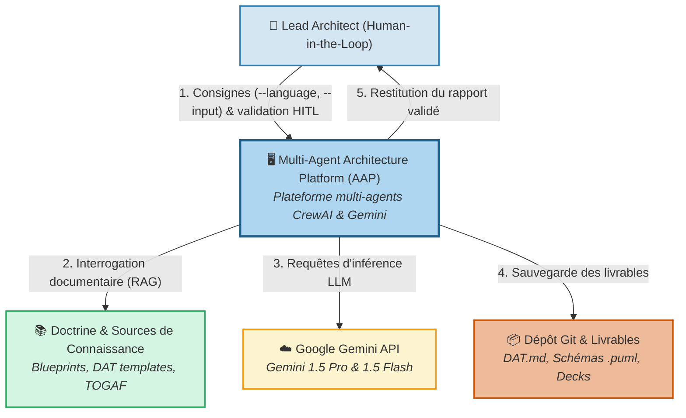
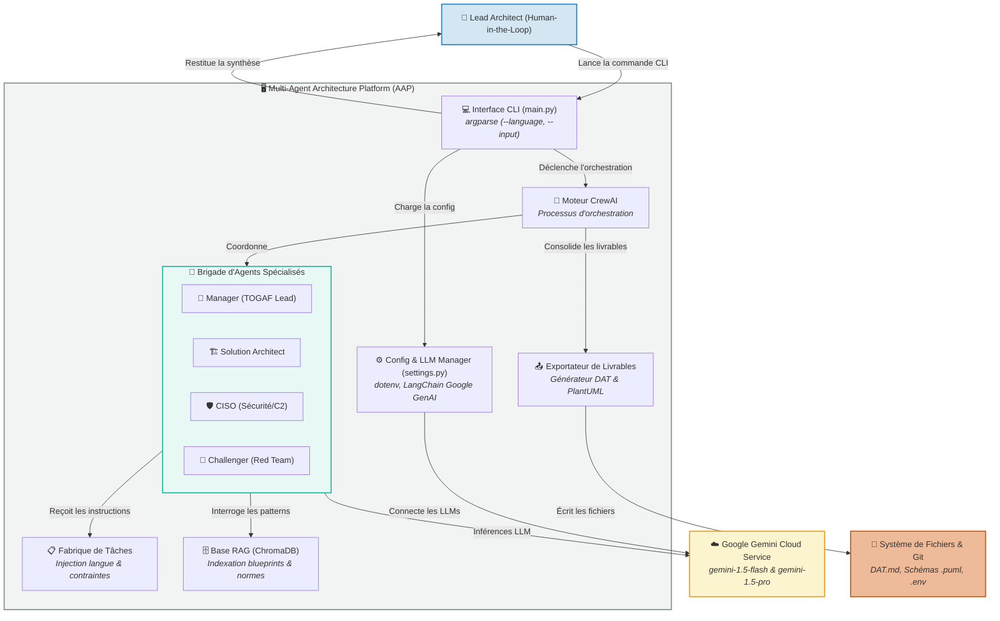
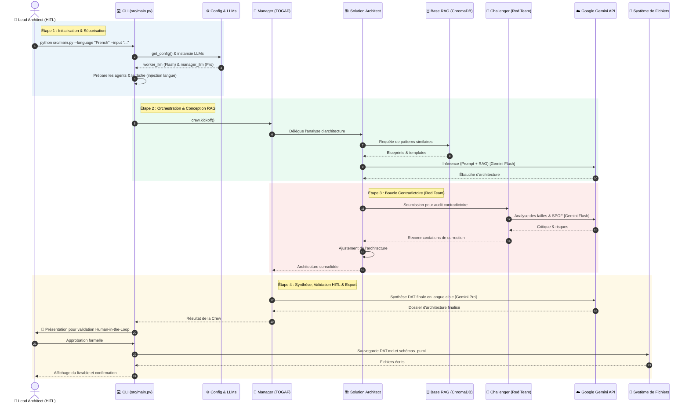

# Dossier d'Architecture Visuelle & Fonctionnelle
## Multi-Agent Architecture Platform (AAP)

**Auteur :** Lead Enterprise & Solution Architect (Software Crafter)  
**Méta-Cadre Référentiel :** TOGAF 10 ADM, SAFe 6, Cloud Well-Architected (WAF), Zero-Trust (NIST), Architecture Hexagonale / DDD, Gouvernance IA (NIST AI RMF / EU AI Act), Classification C2 & Agentic Patterns  
**Version :** 1.1 — Doctrine Multi-Référentiels & Cartographie  
**Date :** Octobre 2026  

---

## 📖 Guide de Lecture
Ce document constitue la **Living Documentation** du projet : il ne se contente pas de présenter des boîtes et des flèches, mais explique **pourquoi** le système est conçu ainsi, **comment** chaque brique interagit, et **quel rôle** joue chaque acteur.

Tous les diagrammes ci-dessous s'affichent automatiquement dans votre navigateur GitHub ou dans VS Code (via le raccourci `Ctrl + Shift + V`). Les fichiers sources éditables (**Draw.io**, **PlantUML** et **Mermaid**) sont directement téléchargeables via les liens fournis.

---

## 0. Le Méta-Cadre Global Multi-Référentiels (Architecture Doctrine)

Dans un environnement d'entreprise moderne, aucun cadre unique ne peut couvrir l'ensemble des dimensions d'une architecture résiliente. La plateforme **AAP** adopte une approche hybride d'ingénierie où **TOGAF fournit le squelette méthodologique**, enrichi par **6 référentiels d'ingénierie et de gouvernance spécialisés**.

```
                           ┌───────────────────────────────────────────────┐
                           │          LEAD ARCHITECT (Humain)              │
                           │   Arbitrage & Décision (Human-in-the-Loop)    │
                           └───────────────────────▲───────────────────────┘
                                                   │
    ┌──────────────────────────────────────────────┴──────────────────────────────────────────────┐
    │                                  AGENT MANAGER (Orchestrateur)                              │
    │  • Méthode & Gouvernance : TOGAF 10 ADM (Phases A à G) + SAFe 6 for Architects             │
    │  • Éthique & Risques IA  : NIST AI RMF + ISO/IEC 42001 + EU AI Act (Transparence/Audits)    │
    └──────┬───────────────────────┬───────────────────────┬───────────────────────┬──────────────┘
           │                       │                       │                       │
┌──────────▼──────────┐ ┌──────────▼──────────┐ ┌──────────▼──────────┐ ┌──────────▼──────────┐
│ SOLUTION ARCHITECT  │ │   CISO / SÉCURITÉ   │ │   SOFTWARE CRAFTER  │ │  SAFE SYSTEM ARCH   │
│ (Macro-Patterns)    │ │ (Sécurité & C2)     │ │ (Micro-Patterns)    │ │ (Agile Delivery)    │
│ • Cloud WAF         │ │ • Zero-Trust (NIST) │ │ • Arch. Hexagonale  │ │ • Enabler Epics     │
│ • EDA / Kafka       │ │ • Classif. C2 massif│ │ • Domain Design DDD │ │ • Features & Stories│
│ • Outbox & Strangler│ │ • Chiffrement (CMK) │ │ • TDD & Clean Code  │ │ • Backlog Jira      │
│ • Circuit Breakers  │ │ • Conformité DCA    │ │ • SOLID, KISS, YAGNI│ │ • DoD opérationnelle│
└──────────┬──────────┘ └──────────┬──────────┘ └──────────┬──────────┘ └──────────┬──────────┘
           │                       │                       │                       │
           └───────────────────────┼───────────────────────┴───────────────────────┘
                                   │
                    ┌──────────────▼─────────────┐
                    │    CHALLENGER / RED TEAM   │
                    │ • Pattern Reflection       │
                    │ • Détection des SPOF       │
                    │ • Traque de l'usine à gaz  │
                    └──────────────┬─────────────┘
                                   │
                    ┌──────────────▼─────────────┐
                    │    AGENT MIGRATION & TCO   │
                    │ • Pilier FinOps & Coûts    │
                    │ • Modèles TCO Cloud        │
                    └────────────────────────────┘
```

### Qui choisit les Patterns d'Architecture ? (La Matrice de Responsabilité)

Le choix des patterns d'architecture s'articule à trois niveaux complémentaires :

| Échelle du Pattern | Responsable | Patterns types sélectionnés | Source de Vérité |
| :--- | :--- | :--- | :--- |
| **1. Macro-Patterns**<br>*(Système, Flux, Résilience)* | **Solution Architect** | • **Event-Driven Architecture (EDA)** : découplage asynchrone Kafka pour charges massives.<br>• **Transactional Outbox** : cohérence BDD / broker d'événements.<br>• **Strangler Fig** : migration progressive vers le Cloud sans effet Big Bang.<br>• **Circuit Breaker** : isolation des pannes externes. | Catalogue Cloud WAF & Base RAG |
| **2. Micro-Patterns**<br>*(Domaine, Code, Testabilité)* | **Software Crafter** | • **Architecture Hexagonale (Ports & Adapters)** : cœur métier indépendant des frameworks.<br>• **Domain-Driven Design (DDD)** : Aggregates, Entities, Value Objects.<br>• **Test Doubles & Inversion de dépendance** : testabilité TDD à 100%. | Standards Craftsmanship & Clean Code |
| **3. Traque de la Sur-Ingénierie**<br>*(Challenge & Simplification)* | **Challenger (Red Team)** | • **Détection du Golden Hammer** : vérifier qu'on ne met pas un pattern complexe (ex: CQRS) là où un simple CRUD suffit.<br>• **Principe YAGNI / KISS** : élimination du code mort anticipé et des briques superflues. | Heuristiques SRE & Anti-patterns |
| **4. Passage au Delivery**<br>*(Exécution dans les Sprints)* | **SAFe Agile Enabler** | • **Découpage vertical** : traduction de chaque pattern en tranches fines (Enabler Epics ➔ User Stories).<br>• **Definition of Done (DoD)** : critères d'acceptation précis pour les équipes de dev. | SAFe 6 Backlog Jira |

### Grille des 7 Référentiels Officiels Intégrés :

| Domaine | Référentiel Officiel & Nom Exact | Rôle au sein de la Plateforme AAP |
| :--- | :--- | :--- |
| **1. Méthode & Cycle de Vie** | **TOGAF 10 ADM** & **SAFe 6 for Architects** | Cadre de gouvernance directeur : structure la démarche en phases (A à G), assure l'alignement stratégique et formalise les Enablers d'architecture. |
| **2. Architecture Cloud** | **Well-Architected Frameworks (WAF)**<br>*(AWS, Azure, Google Cloud)* | Évalue chaque choix selon les 6 piliers : **Excellence opérationnelle, Sécurité, Fiabilité, Efficacité des performances, Optimisation des coûts, Durabilité**. |
| **3. Patterns Logiciels & Données** | **Software Architecture Patterns**<br>*(DDD, Hexagonal, EDA, CQRS)* | Garantit le découplage métier : Ports & Adapters pour isoler le domaine, intégration événementielle asynchrone (Kafka) et patterns de cohérence à terme (Saga). |
| **4. Gouvernance & Éthique de l'IA** | **NIST AI RMF** + **ISO/IEC 42001** + **EU AI Act** | Encadre l'utilisation des agents IA : maîtrise des risques d'hallucination, explicabilité des choix, auditabilité des prompts et traçabilité des décisions. |
| **5. Cybersécurité & Confiance** | **Zero Trust (NIST SP 800-207)** + **OWASP Top 10 for LLMs** | Principe strict *« Never Trust, Always Verify »* : filtrage des entrées/sorties LLM contre le prompt injection, isolation des identités et absence de secrets en dur. |
| **6. Classification des Données** | **Data Classification Standard**<br>*(C0, C1, C2, C2 massif, C3, RGPD)* | Conditionne l'éligibilité au Cloud public, impose le chiffrement au repos et en transit (CMK/HSM), et pré-instruit les Dossiers de Conformité Architecture (DCA). |
| **7. Patterns d'Agents Autonomes** | **Agentic Design Patterns**<br>*(Andrew Ng, LangChain, Anthropic)* | Met en œuvre les 6 patterns d'agents modernes : **Reflection & Critique**, **Tool-Use**, **Planning**, **Orchestrator-Workers**, **Memory/RAG**, et **Human-in-the-Loop**. |

---

## 1. C4 Modèle — Niveau 1 : Contexte Système

### A. La Scène (Le « Pourquoi »)
La plateforme **AAP** a pour vocation d'automatiser la production des dossiers d'architecture (DAT), des cartographies techniques et des supports de comités d'arbitrage. Elle n'agit pas comme un simple générateur de texte, mais comme une **brigade d'ingénierie d'architecture** : elle prend des notes brutes en entrée, consulte la doctrine d'entreprise, interroge des modèles d'IA spécialisés, et soumet ses conclusions à la validation formelle de l'architecte humain avant tout enregistrement dans Git.

### B. Le Schéma Visuel


### C. Anatomie des Acteurs et Systèmes Externes

| Composant | Nature / Rôle | Responsabilités majeures |
| :--- | :--- | :--- |
| **Lead Architect** | Utilisateur expert (*Human-in-the-Loop*) | Fournit les consignes de cadrage (`--input`), choisit la langue (`--language`), et valide les décisions techniques. |
| **Plateforme AAP** | Système central (Python / CrewAI) | Coordonne la brigade d'agents, applique le framework TOGAF, et produit les livrables d'architecture. |
| **Doctrine & Connaissances** | Base documentaire d'entreprise | Fournit les référentiels de normes, les règles de sécurité, les matrices de flux et les templates de DAT types. |
| **Google Gemini API** | Fournisseur de LLM Cloud | Fournit la puissance de calcul IA : `gemini-1.5-flash` pour les tâches ouvrières rapides, `gemini-1.5-pro` pour le raisonnement. |
| **Dépôt Git & Fichiers** | Cible de persistance (*Architecture-as-Code*) | Conserve l'historique des dossiers techniques, des schémas de modélisation et des présentations. |

### D. Explication des Échanges (Flux pas à pas)
1. **Consignes & Paramètres :** L'architecte lance la CLI en précisant la langue cible et son expression de besoin brute.
2. **Interrogation RAG :** Le système recherche les précédents applicatifs et les normes d'architecture applicables.
3. **Inférence LLM :** Les agents formulent leurs propositions en dialoguant avec les modèles Gemini via l'API sécurisée.
4. **Persistance :** Les livrables approuvés sont écrits sur disque au format Markdown et PlantUML.
5. **Restitution :** L'architecte reçoit le résultat final consolidé et prêt à l'emploi.

🔗 **Fichiers sources :** [Draw.io (.drawio)](./diagrams/c4_level1_system_context.drawio) | [PlantUML (.puml)](./diagrams/c4_level1_system_context.puml) | [Mermaid (.mmd)](./diagrams/c4_level1_system_context.mmd)

---

## 2. C4 Modèle — Niveau 2 : Conteneurs Applicatifs

### A. La Scène (Le « Comment »)
Ce niveau décompose l'intérieur de l'application Python. On y observe le découpage modulaire respectant les principes du **Clean Architecture** et du **Software Craftsmanship** : l'interface utilisateur (CLI) est découplée de la gestion des configurations, du moteur d'orchestration multi-agents, et des outils d'exportation.

### B. Le Schéma Visuel


### C. Anatomie des Briques Logicielles Internes

| Brique Logicielle | Fichier source | Rôle & Responsabilité |
| :--- | :--- | :--- |
| **Interface CLI** | `src/main.py` | Parse les arguments en ligne de commande, gère le cycle de vie principal et affiche les résultats. |
| **Config & LLMs** | `src/config/settings.py` | Charge le `.env`, vérifie la présence de la clé Gemini, instancie les objets `ChatGoogleGenerativeAI` avec les bons modèles. |
| **Moteur CrewAI** | `crewai.Crew` | Moteur d'exécution séquentiel qui coordonne les agents, gère la mémoire contextuelle et passe les données entre étapes. |
| **Brigade d'Agents** | `src/agents/architect_agents.py` | Définit les personas spécialisés (Manager, Solution Architect, et futurs CISO / Challenger). |
| **Fabrique de Tâches**| `src/tasks/architecture_tasks.py`| Formalise les prompts techniques et force la rédaction dans la langue demandée (`--language`). |
| **Base RAG** | `ChromaDB` (Local) | Stocke sous forme vectorielle les architectures passées et les règles TOGAF pour nourrir les requêtes. |
| **Exportateur** | `src/tools/` | Génère les fichiers physiques sur disque (`DAT.md`, `.puml`, `.drawio`). |

🔗 **Fichiers sources :** [Draw.io (.drawio)](./diagrams/c4_level2_container.drawio) | [PlantUML (.puml)](./diagrams/c4_level2_container.puml) | [Mermaid (.mmd)](./diagrams/c4_level2_container.mmd)

---

## 3. Diagramme de Séquence : Le Workflow d'Orchestration

### A. La Scène (Le « Quand » & « Comment »)
Ce diagramme détaille la vie d'une requête d'architecture, depuis la commande dans le terminal jusqu'à l'écriture des fichiers. Il met en lumière le pattern d'IA moderne **Reflection & Critique** : le Solution Architect ne travaille pas seul, son travail est audité contradictoirement par un agent Challenger (Red Team) avant d'être validé.

### B. Le Schéma Séquentiel


### C. Déroulement Détaillé des 4 Phases

#### Étape 1 : Initialisation & Sécurisation
* L'utilisateur exécute la commande avec ses paramètres.
* Le gestionnaire de configuration vérifie la présence du `.env` et prépare les deux profils de modèles LLM (`gemini-1.5-flash` pour les opérations rapides et `gemini-1.5-pro` pour le raisonnement de haut niveau).
* La tâche est assemblée en forçant la langue demandée.

#### Étape 2 : Orchestration & Conception RAG
* Le Manager prend les commandes du processus et délègue la conception technique à l'architecte solution.
* L'architecte solution interroge la base documentaire (RAG) pour identifier des solutions similaires ou des contraintes d'entreprise.
* Il formule une première ébauche d'architecture technique.

#### Étape 3 : Boucle Critique (Red Team / Reflection Pattern)
* L'ébauche n'est pas acceptée immédiatement : elle est envoyée à l'agent **Challenger**.
* Le Challenger audite la solution : recherche de points de défaillance uniques (SPOF), évaluation de la sur-ingénierie, conformité sécurité.
* L'architecte solution intègre ces retours pour corriger et consolider son livrable.

#### Étape 4 : Synthèse, Validation Human-in-the-Loop & Export
* Le Manager assemble le document complet au standard TOGAF en s'appuyant sur la puissance rédactionnelle de `gemini-1.5-pro`.
* **Porte d'arrêt obligatoire (HITL) :** Le résultat est présenté à l'architecte en chef qui valide formellement.
* Après validation, les documents physiques (`DAT.md`, `.puml`, `.drawio`) sont écrits dans l'arborescence de fichiers du projet.

🔗 **Fichiers sources :** [PlantUML (.puml)](./diagrams/sequence_architecture_workflow.puml) | [Mermaid (.mmd)](./diagrams/sequence_architecture_workflow.mmd)

---

## 4. Synthèse des Choix d'Architecture (ADRs Clés)

1. **Pourquoi CrewAI plutôt qu'un script simple ?**  
   Pour permettre la délégation hiérarchique, la gestion native des rôles et l'attribution d'outils spécialisés par agent.
2. **Pourquoi dissocier Gemini Flash et Gemini Pro ?**  
   Pour des raisons d'optimisation économique et de latence : 80 % des tâches d'extraction et de relecture intermédiaire coûtent 30x moins cher sur Flash, tandis que Pro est réservé à la synthèse finale du Manager.
3. **Pourquoi trois formats de schémas (PlantUML, Mermaid, Draw.io) ?**  
   *PlantUML* pour la rigueur documentaire sans fioriture, *Mermaid* pour la lisibilité native Markdown dans GitHub, et *Draw.io* pour l'édition graphique libre en atelier.
