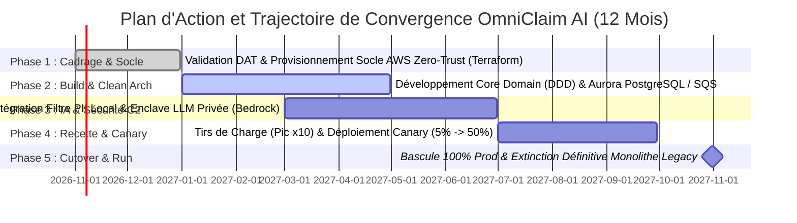

# Décision d'Arbitrage et de Convergence d'Architecture (ARB)
**Programme :** Modernisation du Cœur Sinistres & Déploiement d'Agents IA en Production (OmniClaim AI)  
**Entreprise :** Groupe AssurGlobal  
**Classification des Données :** **C2 MASSIF**  
**Référentiel :** TOGAF 10 ADM, SAFe 6 for Architects, Clean Architecture / DDD, Zero-Trust (NIST SP 800-207) & FinOps  
**Instance d'Arbitrage :** Architecture Review Board (ARB) / Autorité du Lead Architecture Manager  
**Date :** Octobre 2026  

---

## 1. Synthèse exécutive de la décision finale (Décision formelle de l'ARB)

L'Architecture Review Board (ARB), après instruction rigoureuse des livrables produits par la brigade spécialisée (DAT préliminaire, audit critique de la Red Team, avis d'homologation CISO, conception hexagonale du Software Crafter et étude TCO FinOps), prononce une **décision d'arbitrage souveraine, définitive et exécutoire**.

### Décision Formelle : VALIDATION SOUS CONDITIONS STRICTES DE RECONCEPTION (CONVERGENCE ARCHITECTURALE)

1. **Validation du besoin métier et du ROI :** L'objectif business (réduction du Time-to-Indemnize à < 15 min, élasticité x10 en cas de pic climatique et détection antifraude à > 80 M€/an) est entériné. Le retour sur investissement estimé à **1 400% sur 3 ans** (TCO Trajectoire C de 2,92 M€ à 3,70 M€) valide l'opportunité stratégique de la modernisation.
2. **Rejet de la sur-ingénierie (Acceptation partielle de la Red Team) :** 
   * Le **Multi-Cloud Hybride AWS/Azure** est **formellement rejeté et éliminé** en raison de sa complexité, de son coût en data transfer et du SPOF majeur introduit par la liaison inter-cloud. La cible sera 100% **Single-Cloud souverain sur AWS** (`eu-west-1`).
   * Le cluster de streaming lourd **AWS MSK (Kafka)** est **supprimé** pour 1,4 req/sec nominal. Il est remplacé par une architecture synchrone/asynchrone légère adossée à une base relationnelle unique et des files d'attente natives (AWS SQS / workers applicatifs).
   * Le Service Mesh **Istio** est **supprimé** au profit du chiffrement TLS natif et des groupes de sécurité VPC AWS.
3. **Maintien des exigences de sécurité et de conformité (C2 MASSIF) :** L'avis d'homologation du CISO est entériné avec obligation absolue d'une dé-identification locale des PII (NER/Regex dans les pods EKS) avant tout traitement par l'enclave LLM hébergée en mode privé (AWS Bedrock / instances isolées) dans la même région.

---

## 2. Tableau des divergences identifiées et arbitrages rendus

| Axe d'Architecture | Option Initiale (DAT Préliminaire) | Critique Red Team (Challenger) | Décision Arbitrée & Définitive (ARB) |
| :--- | :--- | :--- | :--- |
| **Topologie Cloud** | **Multi-Cloud Hybride** : Ingestion AWS (`eu-west-1`) + IA Azure (`francecentral`) via ExpressRoute/PrivateLink. | **Alerte SPOF & Surcoût** : Risque de coupure du pont inter-cloud, latence non maîtrisée, complexité IAM et double facturation. | **Mono-Cloud AWS Souverain** : Tout déployer exclusivement sur la région AWS `eu-west-1` (avec AWS Bedrock / LLM privé régional) pour supprimer le pont inter-cloud et réduire la surface d'attaque. |
| **Bus de Messages** | **AWS MSK (Kafka)** : 24 partitions, topics distribués, pattern Transactional Outbox lourd. | **Sur-ingénierie critique** : Aberrant pour 1,4 req/sec en nominal (0,69 Mo/s). Complexité opérationnelle injustifiée. | **Suppression de Kafka** : Remplacement par une file d'attente native (AWS SQS) et un pattern de persistance transactionnelle simple sur Aurora PostgreSQL. |
| **Maillage Réseau** | **Istio Service Mesh** : Sidecars Envoy, mTLS inter-services automatisé. | **Surcharge CPU/Mémoire inutile** : Complexité de debugging disproportionnée pour le volume applicatif. | **Suppression d'Istio** : Utilisation du chiffrement TLS natif, des Security Groups AWS et des Network Policies Kubernetes. |
| **Stratégie FinOps** | **Trajectoire B/D** (PaaS managé ou Lakehouse unifié avec TCO de 3,6 M€ à 4,7 M€). | **Attention au vendor lock-in** et à l'explosion des coûts d'I/O et de compute analytique pour du transactionnel. | **Adoption de la Trajectoire C (Cloud-Native Souverain sur EKS)** : TCO optimisé à 3 ans (2,92 M€ - 3,70 M€), élasticité KEDA et ROI maximal (> 1400%). |
| **Sécurité & PII (C2)** | Anonymisation avant Azure AI via pont réseau sécurisé. | Risque de fuite PII en cas de latence ou de faille de l'enclave tierce. | **Dé-identification locale stricte (Zero-Trust)** : Filtrage NER/Regex exécuté obligatoirement dans les pods EKS locaux avant toute inférence. Clés CMK dédiées (AWS KMS). |

---

## 3. Architecture cible consolidée et réconciliée (Sans contradiction interne)

L'architecture cible unifiée repose désormais sur un modèle **Clean Architecture / DDD Mono-Cloud AWS**, éliminant tout artifice de sur-ingénierie distribuée tout en garantissant un niveau de sécurité et de résilience bancaire (C2 MASSIF).

### A. Topologie Réseau et Déploiement Cible (AWS Single-Cloud)
* **Région unique :** `eu-west-1` (Irlande / Souveraineté européenne) répartie sur 3 Zones de Disponibilité (Multi-AZ : AZ-A, AZ-B, AZ-C).
* **Périmètre Sécurisé :** 
  * AWS WAF & Application Load Balancer (ALB) en frontal public.
  * Subnets privés isolés pour les pods EKS (Workers Node Group `m6i.4xlarge` avec autoscaling KEDA).
  * Subnets isolés pour la base de données relationnelle (Aurora PostgreSQL Multi-AZ avec PgBouncer) et les buckets S3 immuables chiffrés par clés maîtresses client (CMK AWS KMS).
  * Enclave d'inférence LLM hébergée en mode privé au sein du même VPC AWS (via AWS Bedrock / instances privées isolées par PrivateLink, garantissant zéro réentraînement sur les données clients).

### B. Conception Logicielle et Flux Métier Consolidé (Hexagonale / DDD)
* **Architecture Hexagonale par microservices métiers légers :**
  * *Inbound Adapters :* Contrôleurs REST, Webhooks sécurisés, consommateurs AWS SQS.
  * *Core Domain (DDD) :* Use Cases métiers purs (ClaimProcessingUseCase), objets de valeur (Amount, ClaimStatus), agrégats de sinistre.
  * *Outbound Adapters :* Adaptateur de persistance (Aurora PostgreSQL), adaptateur d'inférence IA (LLM sécurisé), adaptateur de notification et de paiement SEPA.
* **Séquence de traitement unifiée :**
  1. Soumission du dossier (Photos + PDF de devis) via l'API Gateway AWS.
  2. Ingestion synchrone/asynchrone légère via SQS et traitement par le microservice métier sur EKS.
  3. **Masquage local des PII** (NIR, IBAN, noms) par le module NER intégré au pod EKS.
  4. Appel d'inférence sécurisé vers l'enclave LLM privée pour obtenir le score de fraude et la normalisation des dommages.
  5. Évaluation par le moteur de règles métier :
     * *Cas simple (< 2 000 € & Score < 0.15) :* Déclenchement automatique du virement SEPA.
     * *Cas complexe ou ambigu (>= 2 000 € ou Score >= 0.15) :* Suspension et assignation à la corbeille humaine (HITL - Human-in-the-Loop).

---

## 4. Trajectoire de transition et plan d'action immédiat (Feuille de route SAFe & FinOps)

Le plan de transition opérationnel est exécuté sur **12 mois** sous la gouvernance conjointe de l'Architecte d'Entreprise, du CISO et du Lead FinOps :

### Plan d'Action Immédiat (Jalons Clés) :
1. **Mois 1 à 2 (Nov - Déc 2026) :** Publication du DAT consolidé entérinant le choix Mono-Cloud AWS et la suppression de Kafka/Istio. Provisionnement automatisé du socle Infrastructure as Code (OpenTofu/Terraform) avec activation des balises de gouvernance FinOps (*Cost Allocation Tags*).
2. **Mois 3 à 6 (Jan - Avr 2027) :** Construction du cœur de domaine selon les principes du Software Craftsmanship (TDD, Clean Architecture). Mise en place de la base Aurora PostgreSQL et des files SQS.
3. **Mois 5 à 8 (Mar - Juin 2027) :** Implémentation du filtre PII local et raccordement à l'enclave LLM sécurisée. Réalisation des tirs de charge de validation sur l'environnement PERF (simulation du pic x10 / 5 000 dossiers/heure).
4. **Mois 9 à 10 (Juil - Aoû 2027) :** Déploiement Canary en production (bascule progressive du trafic de 5% à 50%). Surveillance active des SLI/SLO (latence P99 < 1.5s, disponibilité 99,99%).
5. **Mois 11 à 12 (Sep - Oct 2027) :** Bascule totale (100% des flux sur OmniClaim AI) et **extinction définitive du monolithe legacy (WebLogic / Oracle RAC On-Premise)**, matérialisant immédiatement l'économie des licences et l'atteinte du ROI cible (> 1400%).

*Décision validée et ratifiée par le Lead Architecture Manager au nom de l'Architecture Review Board (ARB).*