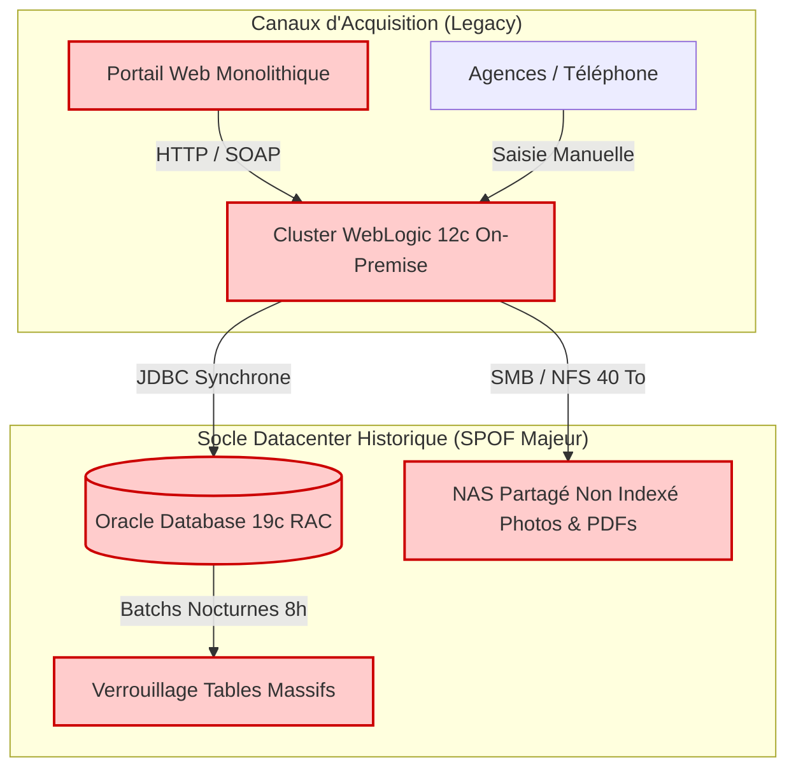
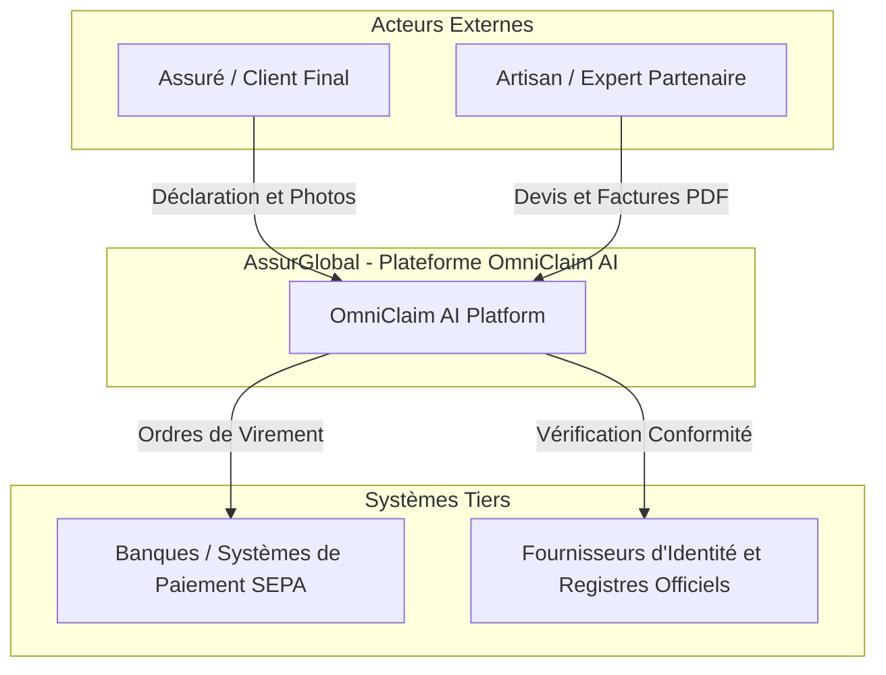
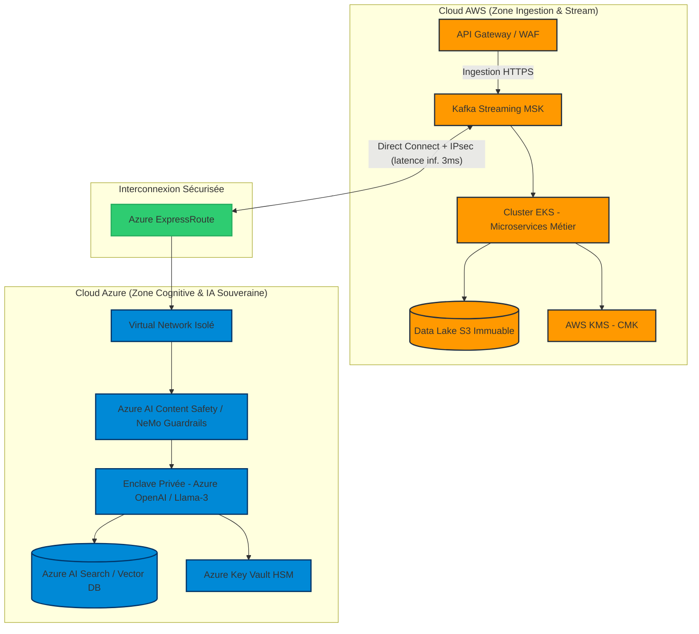
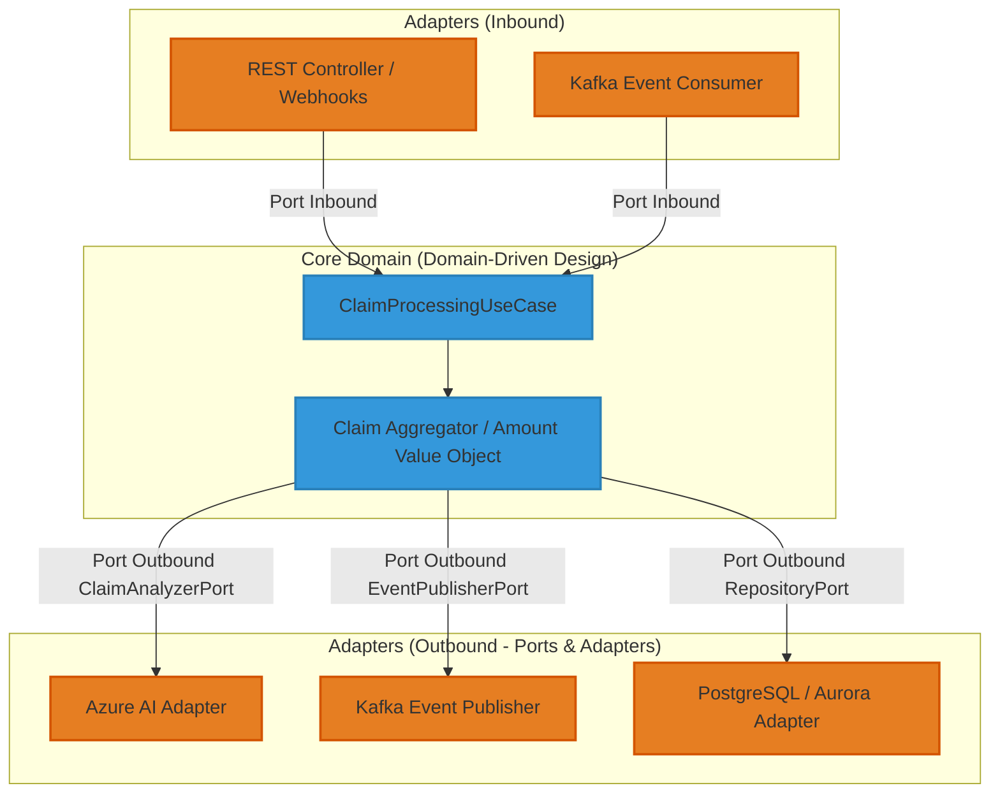
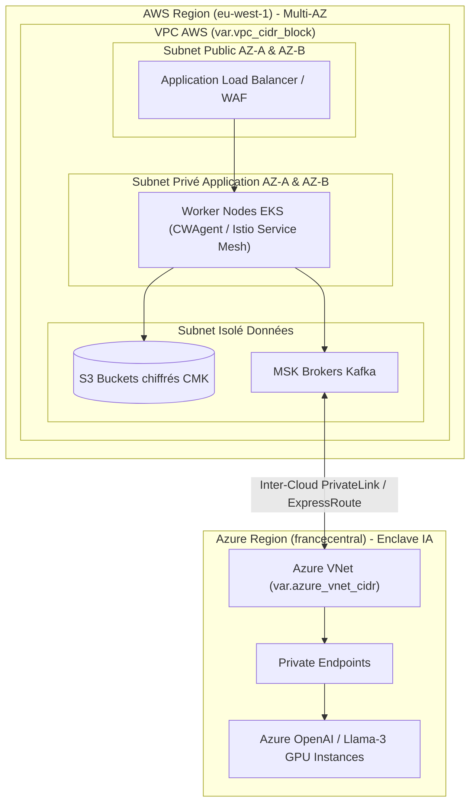
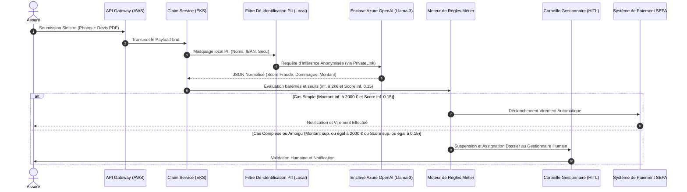

# Dossier d'Architecture Technique (DAT) : Plateforme OmniClaim AI
**Programme :** Modernisation du Cœur Sinistres & Déploiement d'Agents IA en Production  
**Entreprise :** Groupe AssurGlobal (Assurance IARD & Santé — 15 millions de dossiers par an)  
**Classification des Données :** **C2 MASSIF**  
**Cadre Référentiel :** TOGAF 10 ADM, SAFe 6 for Architects, Software Craftsmanship (Hexagonale / DDD / TDD), Zero-Trust (NIST SP 800-207) & FinOps  
**Date :** Octobre 2026  

---

## 1. 🏛️ Synthèse du besoin & Vision d'architecture (Phase A TOGAF)

### Objectifs business et drivers stratégiques
Le Groupe AssurGlobal fait face à des inefficiences structurelles majeures qui impactent directement sa compétitivité et sa promesse client :
1. **Réduction drastique du Time-to-Indemnize :** Passer d'un délai moyen de **7 à 10 jours ouvrés** à une résolution automatisée en moins de **15 minutes** pour les dossiers éligibles, et de moins de **48 heures** pour les cas complexes nécessitant une intervention humaine.
2. **Élasticité instantanée face aux pics climatiques :** Absorber des multiplications de volume par **10 en 24 heures** lors d'événements météorologiques majeurs sans dégradation du service.
3. **Optimisation financière et lutte antifraude :** Libérer les 75% de temps des gestionnaires consacrés à la saisie manuelle et industrialiser la détection de la fraude documentaire (bénéfice cible > 80 M€/an).

### Modélisation de l'architecture existante (AS-IS)
L'infrastructure actuelle repose sur un monolithe Java EE hébergé sur des machines virtuelles VMware On-Premise, souffrant de goulots d'étranglement critiques (SPOF) :



* **Points de Douleur (SPOF & Dette) :** Verrouillage transactionnel massif sur les tables d'indemnisation lors des batchs nocturnes de 8 heures, absence totale d'élasticité à l'échelle, et incapacité structurelle à traiter des flux multimodaux par IA.

---

## 2. 🗺️ Cartographie C4 TO-BE Complète (Multi-Cloud Hybride)

### Niveau 1 : System Context (L1)


### Niveau 2 : Container Diagram (L2)


### Niveau 3 : Component Diagram (L3 - Architecture Hexagonale d'un Microservice Clé)


### Niveau 4 : Deployment & Network Topology (L4 - Multi-AZ AWS / Azure)


### Diagramme de Séquence de Bout en Bout


---

## 3. 📊 Dimensionnement Capacitaire & Volumétrie Quantifiée

### Hypothèses de Volumétrie
* **Volume annuel :** 15 millions de dossiers par an.
* **Charge nominale :** 500 dossiers/heure en régime permanent.
* **Pic exceptionnel (Tempête / Catastrophe naturelle) :** Multiplié par 10 en 24 heures $\rightarrow$ **5 000 dossiers/heure** en pointe, soit environ **1,4 dossier/seconde**.
* **Poids moyen d'un dossier :** 5 Mo (photos haute définition + PDF de devis).

### Dimensionnement des Infrastructures (Compute & Stream)
1. **Clusters Kubernetes (AWS EKS & Azure AKS) :**
   * *Calcul de charge :* 1,4 req/sec $\times$ 3 sec (temps de traitement pipeline synchrone) = 4,2 pods actifs en nominal. En pointe x10 + marge de tolérance de 50% = **35 pods actifs**.
   * *Dimensionnement Node Groups :* Instances `m6i.4xlarge` (16 vCPU, 64 Go RAM). Autodimensionnement par Horizontal Pod Autoscaler (HPA) couplé à KEDA (basé sur la longueur des files d'attente Kafka).
2. **Cluster de Streaming (AWS MSK) :**
   * *Débit entrant nominal :* $500 \times 5 \text{ Mo} / 3600 = 0,69 \text{ Mo/s}$.
   * *Débit entrant pic :* $5 \ 000 \times 5 \text{ Mo} / 3600 = 6,94 \text{ Mo/s}$.
   * *Partitionnement Kafka :* 24 partitions pour la topic `claims.ingest.v1` garantissant un parallélisme optimal et une absorption sans saturation. Rétention des messages fixée à 7 jours sur SSD gp3 (IOPS provisionnées 3000, Throughput 125 Mo/s).
3. **Bases de Données (PostgreSQL / Aurora Multi-AZ) :**
   * *Instances primaires :* Aurora PostgreSQL `db.r6g.4xlarge` (16 vCPU, 128 Go RAM) avec 2 Read Replicas distribuées sur 3 Zones de Disponibilité (Multi-AZ).
   * *Pool de connexions :* Utilisation systématique de PgBouncer pour maintenir un pool mutualisé de 500 connexions actives.

---

## 4. 🔒 Sécurité Zero-Trust, Chiffrement & Garde-Fous IA (C2 MASSIF)

### Authentification & Autorisation
* **mTLS inter-services :** Chiffrement mutuel et authentification stricts au sein du Service Mesh (Istio) avec rotation automatique des certificats x509 toutes les 24 heures.
* **Sécurité Périmétrique & OIDC :** API Gateway validant les jetons JWT signés par le fournisseur d'identité d'entreprise (OAuth 2.0 / OIDC) avec injection de scopes à granularité fine (`claims:write`, `claims:read:pii`).

### Chiffrement & Gestion des Secrets
* **Chiffrement au repos :** Utilisation exclusive de clés maîtresses client (CMK) gérées dans AWS KMS et Azure Key Vault HSM. Rotation des clés activée tous les 365 jours.
* **Chiffrement en transit :** TLS 1.3 obligatoire pour tous les flux externes et internes avec des suites cryptographiques modernes (AES-GCM, ChaCha20-Poly1305).
* **Gestion des secrets :** Injection dynamique des secrets d'infrastructure via HashiCorp Vault / AWS Secrets Manager avec rotation automatique tous les 30 jours (zéro mot de passe en dur dans le code ou les manifests Terraform).

### Garde-Fous IA & Conformité C2 MASSIF
1. **Anonymisation PII locale (Dé-identification) :** Filtrage déterministe par expression régulière et modèles NER locaux (exécutés dans les pods EKS avant sortie du réseau sécurisé) pour masquer les NIR, IBAN, noms et adresses postales avant tout appel vers l'enclave LLM Azure.
2. **Barrière Anti-Prompt Injection :** Intégration de *NeMo Guardrails* et *Azure AI Content Safety* pour intercepter et rejeter tout contenu malveillant ou instruction cachée injectée dans les métadonnées des PDF d'artisans.
3. **Enclave d'Inférence Étanche :** Aucun appel API public. Utilisation stricte d'Azure Private Endpoints. Engagement contractuel et technique garantissant que **les données des assurés ne sont jamais utilisées pour le réentraînement des modèles**.

---

## 5. ⚡ Patterns d'Architecture & Résilience Big Tech

### Résilience et Tolérance aux Pannes
* **Déploiement Multi-AZ :** Répartition active de l'infrastructure sur 3 Zones de Disponibilité distinctes (AZ-A, AZ-B, AZ-C) pour survivre à la perte complète d'un datacenter régional sans interruption.
* **Circuit Breakers & Bulkheads :** Implémentation du pattern Resilience4j sur tous les appels sortants vers les services d'IA et les systèmes bancaires tiers. Isolation des threads pool par domaine métier.
* **Dead Letter Queues (DLQ) :** Isolation automatique de tout message ou payload corrompu après 3 échecs de traitement dans une file d'attente dédiée pour analyse forensique par l'équipe SRE.

### Cohérence des Données & Transactionnalité
* **Transactional Outbox Pattern :** Garantit l'atomicité entre l'écriture en base de données relationnelle et la publication d'événements dans Kafka (zéro perte de message en cas de crash applicatif).
* **Idempotence :** Utilisation systématique d'une clé d'idempotence (`X-Request-ID` / UUID v4) pour chaque déclaration de sinistre et ordre de virement bancaire afin d'éviter les doubles paiements en cas de retries réseau.
* **Saga Pattern (Orchestration) :** Gestion des flux distribués complexes d'indemnisation avec compensations automatiques en cas d'échec d'une étape aval.

### Objectifs de Reprise (RTO / RPO)
* **RTO (Recovery Time Objective) :** $< 15$ minutes grâce à l'autoscaling et à la réplication synchrone des états.
* **RPO (Recovery Point Objective) :** $0$ (Zéro perte de données validées grâce à la persistance synchrone multi-AZ sur Aurora et aux topics Kafka répliqués sur 3 brokers).

---

## 6. 🌍 Topologie des Environnements & Stratégie de Déploiement

### Ségrégation Étanche des 4 Environnements
1. **DEV (Développement) :** Comptes Cloud isolés pour le prototypage des développeurs, bases de données éphémères, LLM simulés (Mocks).
2. **INT (Intégration & Recette Métier) :** Environnement de validation fonctionnelle interconnecté avec les briques de test partenaires.
3. **PERF (Tirs de Charge & Performance) :** Environnement dimensionné à l'identique de la production pour valider l'absorption du pic x10 (simulation de tempêtes climatiques).
4. **PROD (Production) :** Environnement hautement sécurisé, cloisonné et audité en continu.

### Stratégie de Déploiement Continu
* **Canary & Blue-Green Deployments :** Déploiement progressif des microservices via ArgoCD et Istio (routage initial de 5% du trafic vers la nouvelle version, analyse des métriques d'erreur pendant 15 minutes, puis bascule à 100%).

---

## 7. 💻 Squelette d'Infrastructure as Code (Terraform / OpenTofu)

Voici le module Terraform HCL standardisé et sécurisé déployant le socle réseau, l'enclave et les restrictions Zero-Trust :

```hcl
terraform {
  required_version = ">= 1.6.0"
  required_providers {
    aws = {
      source  = "hashicorp/aws"
      version = "~> 5.0"
    }
  }
}

provider "aws" {
  region = var.aws_region
}

variable "aws_region" {
  type    = string
  default = "eu-west-1"
}

variable "environment" {
  type    = string
  default = "prod"
}

# 1. VPC Sécurisé Zero-Trust Multi-AZ
resource "aws_vpc" "omniclaim_vpc" {
  cidr_block           = var.vpc_cidr_block
  enable_dns_hostnames = true
  enable_dns_support   = true

  tags = {
    Name        = "vpc-omniclaim-${var.environment}"
    Environment = var.environment
    Compliance  = "C2-Massif"
  }
}

# 2. Subnets Privés Isolé pour les Workers EKS
resource "aws_subnet" "private_app_az_a" {
  vpc_id            = aws_vpc.omniclaim_vpc.id
  cidr_block        = var.subnet_app_az_a_cidr
  availability_zone = "${var.aws_region}a"

  tags = {
    Name = "subnet-private-app-${var.environment}-a"
  }
}

# 3. Clé de Chiffrement CMK KMS dédiée (C2 Massif)
resource "aws_kms_key" "omniclaim_cmk" {
  description             = "CMK Dediee pour Chiffrement C2 Massif - OmniClaim AI"
  deletion_window_in_days = 30
  enable_key_rotation     = true

  tags = {
    Name = "kms-omniclaim-${var.environment}"
  }
}

# 4. Bucket S3 Immuable pour Data Lake Stockage Documents
resource "aws_s3_bucket" "datalake_s3" {
  bucket = "assurglobal-omniclaim-datalake-${var.environment}"

  tags = {
    Name = "s3-omniclaim-datalake-${var.environment}"
  }
}

resource "aws_s3_bucket_server_side_encryption_configuration" "s3_encryption" {
  bucket = aws_s3_bucket.datalake_s3.id

  rule {
    apply_server_side_encryption_by_default {
      kms_master_key_id = aws_kms_key.omniclaim_cmk.arn
      sse_algorithm     = "aws:kms"
    }
  }
}

resource "aws_s3_bucket_public_access_block" "s3_block_public" {
  bucket                  = aws_s3_bucket.datalake_s3.id
  block_public_acls       = true
  block_public_policy     = true
  ignore_public_acls      = true
  restrict_public_buckets = true
}

output "vpc_id" {
  description = "ID du VPC OmniClaim"
  value       = aws_vpc.omniclaim_vpc.id
}

output "kms_key_arn" {
  description = "ARN de la cle de chiffrement CMK"
  value       = aws_kms_key.omniclaim_cmk.arn
}
```

---

## 8. 🩺 MCO, Observabilité & Ingénierie SRE (RUN)

### Définition des SLI, SLO & SLA
* **Disponibilité (SLA) :** $99.99\%$ de disponibilité globale de la plateforme de déclaration.
* **Latence (SLO) :** P99 de l'API de traitement synchrone $< 1.5$ seconde (hors inférence lourde asynchrone).
* **Error Budget :** Consommation maximale autorisée de $0.01\%$ d'erreurs par mois calendaire. Déclenchement d'un gel des déploiements (Freeze) en cas de dépassement.

### Observabilité Full-Stack (OpenTelemetry)
* **Traçage Distribué :** Propagation universelle des headers `traceparent` W3C de l'API Gateway AWS jusqu'aux enclaves Azure OpenAI via les adaptateurs.
* **Métriques RED (Rate, Errors, Duration) & USE (Utilization, Saturation, Errors) :** Collecte en temps réel par Prometheus et visualisation sur dashboards Grafana unifiés.
* **Centralisation des Logs :** Agrégation de l'ensemble des logs applicatifs, d'audit et de sécurité dans un cluster OpenSearch immuable avec masquage automatique des PII résiduelles.

### Matrice des Astreintes & Runbook d'Incident
* **Organisation 24/7 :** Rotation d'astreinte sur 3 niveaux (Niveau 1 : SRE / DevOps d'alerte, Niveau 2 : Lead Architectes Backend / Data, Niveau 3 : CISO & Directeur Technique).
* **Runbook d'Urgence (Exemple : Saturation IA / Panne Azure OpenAI) :**
  1. *Détection :* Alerte Prometheus sur taux d'erreur 5xx de l'adaptateur Azure $> 2\%$.
  2. *Action Immédiate :* Activation automatique du Circuit Breaker basculant les dossiers non critiques vers le mode synchrone dégradé (routage direct vers la file d'attente HITL humaine avec étiquette « Mode Dégradé IA »).
  3. *Résolution :* Notification des équipes Azure Support et bascule sur le modèle de secours régional si nécessaire.

---
*Fin du Dossier d'Architecture Technique (DAT). Prêt pour instruction et validation formelle par l'Architecture Review Board (ARB).*