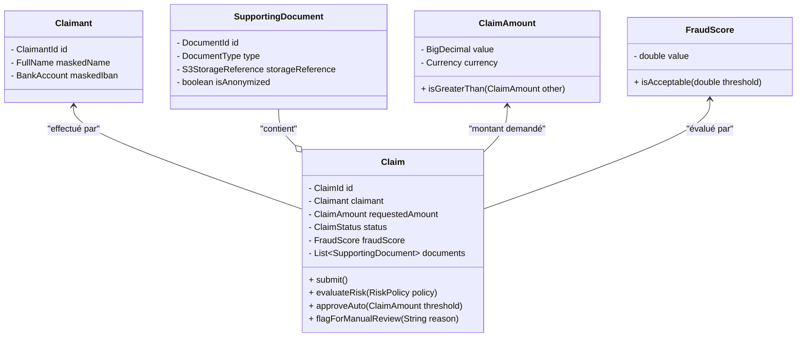

# 🛠️ Guide de Conception Logicielle Software Craftsmanship : Plateforme OmniClaim AI

---

## 1. 🏛️ Spécification de l'Architecture Hexagonale (Ports & Adapters)

L'architecture hexagonale isole strictement le cœur de métier (Domain Core) des préoccupations d'infrastructure (bases de données, bus de messages, passerelles LLM, frameworks web). Le flux des dépendances est unidirectionnel et pointe **toujours vers le centre**.

### Schéma Textuel du Découplage

```
+------------------------------------------------------------------------------------------+
|                                ADAPTATEURS D'ENTRÉE (Inbound / Drivers)                  |
|   [ REST Controllers / Webhooks ]        [ Kafka Event Consumers ]                       |
+------------------------------------------------------------------------------------------+
                                               |
                                     (Implémente / Appelle)
                                               v
+------------------------------------------------------------------------------------------+
|                                   PORTS D'ENTRÉE (Inbound Ports)                         |
|   - ClaimProcessingUseCase (Interface Métier)                                            |
|   - AssessClaimRiskUseCase (Interface Métier)                                            |
+------------------------------------------------------------------------------------------+
                                               |
                                            (Utilise)
                                               v
+------------------------------------------------------------------------------------------+
| 🟣 CŒUR DE DOMAINE (Domain Core / DDD)                                                   |
|   - Agrégats : Claim (Racine), Document, Assessment                                      |
|   - Entités : Claimant, Incident                                                         |
|   - Value Objects : ClaimId, ClaimAmount, FraudScore, Currency, PiiMaskedText            |
|   - Services de Domaine : RiskEvaluationService, FraudDetectionDomainService             |
+------------------------------------------------------------------------------------------+
                                               |
                                        (Définit les Ports)
                                               v
+------------------------------------------------------------------------------------------+
|                                 PORTS DE SORTIE (Outbound Ports)                         |
|   - ClaimRepositoryPort (Interface de persistance)                                       |
|   - DocumentStoragePort (Interface de stockage S3)                                       |
|   - AiAnalyzerPort (Interface d'inférence LLM)                                           |
|   - EventPublisherPort (Interface de publication de messages)                            |
+------------------------------------------------------------------------------------------+
                                               |
                                     (Implémenté par les Adaptateurs)
                                               v
+------------------------------------------------------------------------------------------+
|                              ADAPTATEURS DE SORTIE (Outbound / Driven)                   |
|   [ PostgreSQL / Aurora Adapter ]   [ AWS S3 Adapter ]   [ Azure OpenAI / LLM Adapter ]  |
+------------------------------------------------------------------------------------------+
```

### Description Détaillée des Composants de l'Hexagone

1. **Ports d'Entrée (Drivers / Inbound) :**
   * `ClaimProcessingUseCase` : Interface définissant la signature du traitement de la déclaration de sinistre (`ProcessClaimCommand`). Exposée via un contrôleur REST Spring Boot ou un consommateur de messages asynchrone léger.
2. **Ports de Sortie (Driven / Outbound) :**
   * `AiAnalyzerPort` : Contrat abstrayant l'appel au service d'analyse cognitive (LLM). Le cœur métier ignore totalement si l'analyse est effectuée par Azure OpenAI, un modèle local ou un stub de test.
   * `ClaimRepositoryPort` : Contrat d'accès aux données, garantissant que l'entité persistante est convertie en modèle de domaine pur et vice-versa via des *Mappers* dédiés.
3. **Adaptateurs (Adapters) :**
   * **Inbound :** `RestClaimController` (traduit les requêtes HTTP en commandes métier) et `ClaimKafkaConsumer` (traduit les messages de la file d'attente en commandes).
   * **Outbound :** `PostgresClaimRepository` (implémente `ClaimRepositoryPort` via Spring Data / JPA), `AzureOpenAiAdapter` (implémente `AiAnalyzerPort` via WebClient avec gestion du circuit breaker Resilience4j).

---

## 2. 🗺️ Modélisation Domain-Driven Design (DDD)

Le Bounded Context retenu est **`ClaimsManagement`** (Gestion des Sinistres IARD & Santé). Il encapsule l'ensemble du cycle de vie d'un sinistre, de sa déclaration automatisée jusqu'à son indemnisation ou son basculement en revue humaine (HITL).

### Modèle Conceptuel du Domaine



### Définitions Rigoureuses des Éléments DDD

1. **Bounded Context :** `ClaimsManagement` (isole le domaine des sinistres des contextes de facturation, de gestion des contrats et de la relation client).
2. **Agrégat Racine (Aggregate Root) :**
   * **`Claim` (Sinistre) :** Garant l'invariant transactionnel de l'ensemble du dossier. Aucune modification d'un document ou d'un statut ne peut être effectuée en contournant l'Agrégat Racine.
3. **Entités (Entities) :**
   * **`Claimant` (Assuré) :** Objet doté d'une identité propre (`ClaimantId`), contenant les coordonnées masquées (conformité C2 Massif / RGPD).
   * **`SupportingDocument` (Pièce Justificative) :** Entité interne à l'agrégat représentant un devis, une facture ou une photo géolocalisée.
4. **Value Objects (Objets de Valeur - Immuables) :**
   * **`ClaimId` :** Identifiant fort encapsulant un UUID v4.
   * **`ClaimAmount` :** Encapsule un `BigDecimal` strictement positif et une `Currency` (ISO 4217). Interdit les opérations arithmétiques hasardeuses en garantissant l'arriméntage monétaire.
   * **`FraudScore` :** Encapsule un ratio décimal compris entre `0.0` et `1.0`.
   * **`PiiMaskedText` :** Value object assurant que le texte brut soumis à l'IA a subi un masquage irréversible des données sensibles (NIR, IBAN, adresses).

---

## 3. 🧪 Stratégie de Testabilité Unitaire (TDD 100%)

La testabilité unitaire absolue est la pierre angulaire de notre démarche Software Craftsmanship. Le Cœur de Domaine respecte la règle d'or : **Zéro dépendance d'infrastructure, zéro framework tiers lourd (pas de Spring Context, pas de base de données embarquée, pas de connexion réseau) dans les tests unitaires du domaine.**

### Pyramide des Tests & Typologie Déterministe

```
       /\
      /  \      Tests de Bout en Bout (E2E / Playwright / Postman) - < 5%
     /----\
    /      \    Tests d'Intégration (Testcontainers PostgreSQL / Kafka) - ~15%
   /--------\
  /          \  Tests Unitaires Adaptateurs (Mocks de l'infra) - ~20%
 /------------\
/              \ Tests Unitaires Purs du Domaine (TDD 100% Mockist/Classical) - > 60%
----------------
```

### Exemple de Test Unitaire Pur (TDD / JUnit 5 + AssertJ)

Ce test valide l'invariant métier : *Un sinistre dont le montant dépasse 2000 € ou dont le score de fraude dépasse 0.15 ne peut être approuvé automatiquement et doit basculer en revue humaine (HITL).*

```java
package com.assurglobal.omniclaim.domain.model;

import com.assurglobal.omniclaim.domain.exception.DomainInvariantViolationException;
import org.junit.jupiter.api.DisplayName;
import org.junit.jupiter.api.Test;
import org.junit.jupiter.params.ParameterizedTest;
import org.junit.jupiter.params.provider.CsvSource;

import java.math.BigDecimal;
import java.util.Currency;

import static org.assertj.core.api.Assertions.assertThat;
import static org.assertj.core.api.Assertions.assertThatThrownBy;

class ClaimTest {

    @Test
    @DisplayName("Étant donné un sinistre simple, lorsque le montant est inférieur à 2000 et le score de fraude bas, l'approbation automatique réussit")
    void given_simple_claim_when_auto_approve_then_status_becomes_approved() {
        // Given
        ClaimId claimId = ClaimId.generate();
        ClaimAmount amount = new ClaimAmount(new BigDecimal("1500.00"), Currency.getInstance("EUR"));
        Claim claim = Claim.createNew(claimId, amount);

        FraudScore lowFraudScore = new FraudScore(0.05);

        // When
        claim.evaluateAndProcess(lowFraudScore, new ClaimAmount(new BigDecimal("2000.00"), Currency.getInstance("EUR")));

        // Then
        assertThat(claim.getStatus()).isEqualTo(ClaimStatus.AUTO_APPROVED);
    }

    @ParameterizedTest
    @CsvSource({
        "2500.00, 0.05", // Montant supérieur au seuil
        "1200.00, 0.25"  // Score de fraude supérieur au seuil
    })
    @DisplayName("Étant donné un sinistre complexe, lorsque le seuil est dépassé, le dossier bascule obligatoirement en revue humaine (HITL)")
    void given_complex_claim_when_evaluate_then_requires_manual_review(String amountStr, double fraudVal) {
        // Given
        ClaimId claimId = ClaimId.generate();
        ClaimAmount amount = new ClaimAmount(new BigDecimal(amountStr), Currency.getInstance("EUR"));
        Claim claim = Claim.createNew(claimId, amount);

        FraudScore highFraudScore = new FraudScore(fraudVal);
        ClaimAmount threshold = new ClaimAmount(new BigDecimal("2000.00"), Currency.getInstance("EUR"));

        // When
        claim.evaluateAndProcess(highFraudScore, threshold);

        // Then
        assertThat(claim.getStatus()).isEqualTo(ClaimStatus.PENDING_MANUAL_REVIEW);
    }
}
```

---

## 4. 🧼 Directives Clean Code, SOLID & KISS/YAGNI pour les Équipes de Build

Les développeurs des équipes de build doivent appliquer rigoureusement les directives suivantes lors de l'implémentation du code source :

### A. Application des Principes SOLID
* **Single Responsibility Principle (SRP) :** Une classe, un service, un use case n'a qu'une seule raison de changer. Par exemple, ségréguer strictement la logique de calcul du risque (Domain Service) de la logique d'orchestration transactionnelle (Application Use Case).
* **Open/Closed Principle (OCP) :** Le moteur de règles et l'analyseur IA doivent être ouverts à l'extension (nouveaux adaptateurs de LLM ou nouvelles stratégies de scoring) mais fermés à la modification grâce à l'injection des interfaces (Ports).
* **Liskov Substitution Principle (LSP) :** Toute implémentation d'un Port (ex: `PostgresClaimRepository` ou `InMemoryClaimRepository` pour les tests) doit respecter strictement les contrats comportementaux et les exceptions déclarées.
* **Interface Segregation Principle (ISP) :** Préférer des interfaces de ports courtes et hautement cohésives (ex: `ClaimReaderPort` et `ClaimWriterPort` séparés si nécessaire) plutôt qu'un port monolithique fourre-tout.
* **Dependency Inversion Principle (DIP) :** Le cœur métier ne dépend jamais des adaptateurs ou des frameworks (Spring, Hibernate, AWS SDK). Ce sont les adaptateurs qui dépendent et implémentent les ports définis par le domaine.

### B. Clean Code & Lisibilité Exigeante
* **Nommage Explicite :** Interdiction absolue des noms génériques ou magiques (`data`, `mgr`, `temp`, `res`). Privilégier un langage ubiquitaire issu directement du domaine métier (ex: `ClaimApprovalPolicy`, `FraudScoreThreshold`).
* **Immutabilité par Défaut :** Tous les Value Objects et les objets de transfert de données (DTOs) doivent être immuables (propriétés `final`, absence de setters, utilisation de `record` en Java 17+).
* **Gestion Stricte des Erreurs :** Interdiction d'utiliser des exceptions génériques (`RuntimeException`, `Exception`). Créer une hiérarchie d'exceptions métiers explicites et typées (ex: `DomainInvariantViolationException`, `ClaimNotFoundException`).
* **Méthodes Courtes :** Une méthode ne doit pas dépasser 20 lignes et ne doit réaliser qu'une seule tâche (principe SLAP - Single Level of Abstraction Principle).

### C. KISS & YAGNI (Lutte contre la Sur-ingénierie)
* **Pas de Complexité Prématurée :** Ne pas implémenter de patterns distribués complexes (Sagas, Event Sourcing lourd, CQRS avec bases multiples) tant que la simplicité d'un service modulaire transactionnel bien structuré suffit amplement à répondre au besoin fonctionnel.
* **KISS (Keep It Simple, Stupid) :** Si une logique métier peut s'écrire de manière linéaire, lisible et déclarative sans abstractions superflues, privilégiez toujours cette approche.

---
*Guide de conception logicielle validé pour l'industrialisation par l'Architecture Review Board (ARB).*