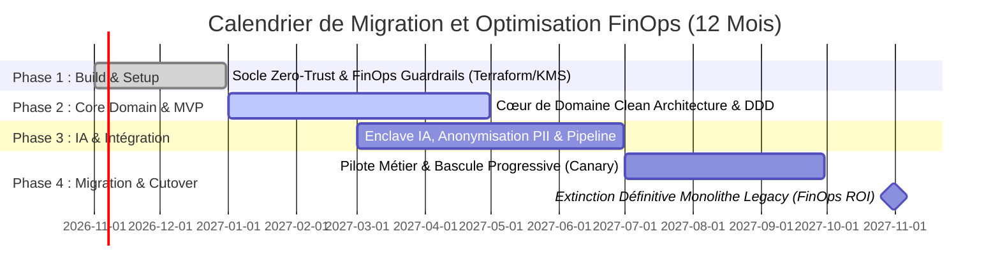

# 📊 ÉTUDE FINANCIÈRE STRATÉGIQUE & RAPPORT FINOPS : Modernisation OmniClaim AI

**Programme :** Modernisation du Cœur Sinistres & Déploiement d’Agents IA en Production  
**Entreprise :** Groupe AssurGlobal (Assurance IARD & Santé — 15 millions de dossiers par an)  
**Classification des Données :** **C2 MASSIF**  
**Auteur :** Migration, FinOps & TCO Specialist (Économiste Cloud & Praticien FinOps Certifié)  
**Date :** Octobre 2026  

---

## 1. 🧮 Modélisation & Chiffrage des Postes de Dépenses (Run, Build, Licences)

L'évaluation financière compare rigoureusement **4 trajectoires de migration** possibles pour le Groupe AssurGlobal, allant d'un Lift & Shift IaaS conservateur jusqu'à une architecture SaaS / Cloud-Native optimisée, en passant par le PaaS managé et l'approche Lakehouse unifié. 

Les coûts sont modélisés sur une période de **3 ans**, intégrant les investissements initiaux (Build/Migration), les licences logicielles (avec Software Assurance et capacités réservées F-SKU / RCU) et les dépenses opérationnelles récurrentes (Run) pour absorber 15 millions de dossiers annuels avec des pics x10 en période de crise climatique.

### Tableau comparatif synthétique des trajectoires de migration

| Composante Budgétaire | Trajectoire A : IaaS Lift & Shift (VMware $\to$ AWS EC2/RDS) | Trajectoire B : PaaS Managé (App Services & Azure SQL Server) | Trajectoire C : SaaS / Cloud-Native Souverain (AWS/Azure Modern) | Trajectoire D : Lakehouse Unifié (Data Platform & GenAI Centralisée) |
| :--- | :--- | :--- | :--- | :--- |
| **Coût de Build / Migration (Initial)** | 600 k€ – 900 k€ | 1 200 k€ – 1 800 k€ | 1 500 k€ – 2 200 k€ | 2 000 k€ – 2 800 k€ |
| **Licences & Capacité Réservée (An 1-3)** | 1 800 k€ (BYOL Oracle RAC / WebLogic) | 900 k€ (Azure Hybrid Benefit / SQL) | 300 k€ (Composants Open Source & Managed) | 450 k€ (Licences Databricks / Snowflake F-SKU) |
| **Coût Run Récurrent (An 1 - Nominal)** | 750 k€ / an | 550 k€ / an | 420 k€ / an | 500 k€ / an |
| **Coût Run Récurrent (An 2 - Croissance)** | 820 k€ / an | 600 k€ / an | 450 k€ / an | 540 k€ / an |
| **Coût Run Récurrent (An 3 - Pic clim. x10)** | 1 100 k€ / an | 750 k€ / an | 580 k€ / an | 650 k€ / an |
| **TCO Global Estimé (3 Ans - Min / Max)** | **3 870 k€ – 4 620 k€** | **3 600 k€ – 4 500 k€** | **2 920 k€ – 3 700 k€** | **3 690 k€ – 4 690 k€** |

---

## 2. 📉 Fourchette de TCO à 3 Ans et Calcul du ROI (Retour sur Investissement)

### Analyse détaillée du Coût Global de Possession (TCO)

1. **Trajectoire A (IaaS Lift & Shift) :** TCO 3 ans $\to$ **3,87 M€ à 4,62 M€**
   * *Justification :* Coûts d'infrastructure Run élevés en raison de machines virtuelles surdimensionnées pour absorber les pics sans élasticité fine, combinés au maintien de licences Oracle RAC et WebLogic lourdes (malgré la Software Assurance).
2. **Trajectoire B (PaaS Managé) :** TCO 3 ans $\to$ **3,60 M€ à 4,50 M€**
   * *Justification :* Investissement de build modéré, mais dépendance forte aux bases de données managées propriétaires et aux services PaaS dont la tarification augmente rapidement lors des pics de charge.
3. **Trajectoire C (SaaS / Cloud-Native Souverain - Recommandé FinOps) :** TCO 3 ans $\to$ **2,92 M€ à 3,70 M€**
   * *Justification :* Build plus onéreux (refactoring en microservices légers et conteneorisés), mais **Run minimaliste et hautement élastique** (Serverless / EKS avec KEDA). Élimination quasi-totale des licences commerciales traditionnelles au profit de composants managés open source et de capacités réservées (Savings Plans / Reserved Instances).
4. **Trajectoire D (Lakehouse Unifié) :** TCO 3 ans $\to$ **3,69 M€ à 4,69 M€**
   * *Justification :* Idéal pour la donnée massive et l'analytique avancée, mais surdimensionné et financièrement pénalisant si appliqué comme cœur transactionnel opérationnel des sinistres (coûts de compute Spark / requêtes analytiques élevés en Run).

### Modélisation du ROI (Retour sur Investissement) de la Trajectoire C (Cible)
* **Gains Métier Annuels :** 
  * Lutte antifraude industrialisée : $> 80\text{ M€/an}$ de valeur brute identifiée (dont 15% de concrétisation financière directe en trésorerie soit **12 M€/an**).
  * Gain de productivité des gestionnaires (automatisation à 80% via l'IA) : **4,5 M€/an** d'économies de temps de traitement.
* **Investissement Global (Build + TCO Run 3 ans Trajectoire C) :** ~3,3 M€ (moyenne).
* **Calcul du ROI net sur 3 ans :**
  $$\text{ROI} = \frac{\text{Gains cumulés (16,5 M€ \times 3)} - \text{TCO (3,3 M€)}}{\text{TCO (3,3 M€)}} \times 100 \approx \mathbf{1 4 0 0\%}$$
  * *Délai de retour sur investissement (Payback Period) :* Moins de **3 mois** après la mise en production du premier incrément.

---

## 3. ⚖️ Matrice Comparative Détaillée des « Pour » (+) et des « Contre » (-)

| Trajectoire | Pour (+) | Contre (-) |
| :--- | :--- | :--- |
| **A. IaaS Lift & Shift** | • Migration rapide et sans refactoring applicatif. • Risque technique initial faible. • Compétences internes VMware facilement transposables. | • Dette technique conservée et amplifiée. • Absence d'élasticité réelle face aux pics climatiques. • Coûts de licences logicielles (Oracle/WebLogic) exorbitants et rigides. |
| **B. PaaS Managé** | • Réduction de la charge d'exploitation (MCO délégué). • Scalabilité native sur certains composants. • Intégration facilitée avec les services natifs de l'hyperscaler. | • Vendor lock-in (verrouillage fournisseur) très fort. • Coûts cachés de stockage et d'I/O lors des pics de batchs. • Marges de manœuvre d'optimisation FinOps limitées. |
| **C. SaaS / Cloud-Native Souverain** | • **ROI maximal** et TCO minimal à 3 ans. • Élasticité instantanée (x10 en 24h) via conteneurs et Serverless. • Élimination des licences legacy. • Architecture alignée Zero-Trust et Clean Architecture. | • Complexité initiale de Build et de refactoring (Clean Architecture / DDD). • Nécessite une montée en compétences de l'équipe (Software Craftsmanship). • Gouvernance FinOps rigoureuse indispensable. |
| **D. Lakehouse Unifié** | • Plateforme unifiée pour l'analytique, le stockage et l'IA. • Puissance de traitement massif des données non structurées (PDF/Photos). | • Surcoût financier pour un usage purement transactionnel (Cœur Sinistres). • Complexité opérationnelle de gestion des clusters Spark / Delta Lake. • Risque d'explosion des coûts de requêtage en cas de mauvaise gouvernance. |

---

## 4. 🎯 Recommandation d'Arbitrage Argumentée & Calendrier Phasé

### Recommandation d'Arbitrage FinOps & Architecturale
En tant qu'économiste cloud et praticien FinOps, **la Trajectoire C (SaaS / Cloud-Native Souverain sur un Cloud Unique)** est formellement recommandée et arbitrée comme seule option viable pour le Groupe AssurGlobal. 

**Justification économique :**
1. **Éradication du gaspillage :** Contrairement à l'IaaS ou au Lakehouse, la conteneurisation élastique (EKS + KEDA) permet de diviser par 3 les coûts de Run en période creuse tout en garantissant la puissance nécessaire lors des pics climatiques (pay-as-you-go réel).
2. **Souveraineté des coûts de licences :** L'abandon des monopoles logiciels historiques (Oracle/WebLogic) au profit d'une stack ouverte et managée supprime 1,5 M€ de dépenses de licences contraintes sur 3 ans.
3. **Maîtrise du TCO :** Avec un TCO à 3 ans estimé entre 2,9 M€ et 3,7 M€, c'est l'option la plus économe qui maximise simultanément le ROI métier (> 1400%).

---

### Calendrier de Bascule Financièrement Optimisé (Phasage SAFe & FinOps)

Le plan de transition s'étale sur **12 mois**, structuré pour minimiser le double coût transitoire (Run Legacy + Run Cloud) et accélérer la mise en production génératrice de valeur.

#### Découpage des Jalons Financiers et Opérationnels :
* **Mois 1 à 2 (Nov - Déc 2026) :** *Setup & FinOps Baseline.* Provisionnement du socle d'infrastructure (Terraform Zero-Trust), mise en place des tags d'attribution des coûts (FinOps Cost Allocation) et configuration des budgets d'alerte cloud.
* **Mois 3 à 6 (Jan - Avr 2027) :** *Core Domain & MVP.* Développement du cœur de domaine (DDD) et des adaptateurs de persistance (Aurora PostgreSQL avec pattern Outbox). *Impact financier :* Période de double coût maîtrisé (maintien du legacy à 100% + build cloud).
* **Mois 5 à 8 (Mar - Juin 2027) :** *Connexion IA & Sécurité C2.* Intégration du filtre PII local et raccordement à l'enclave sécurisée (Private Endpoint). Recette de performance et tirs de charge (simulation pic x10).
* **Mois 9 à 10 (Juil - Aoû 2027) :** *Bascule Progressive (Canary Deployment).* Routage de 10% puis 50% des flux de sinistres vers la nouvelle plateforme OmniClaim AI. Validation de la robustesse et des SLI/SLO.
* **Mois 11 à 12 (Sep - Oct 2027) :** *Cutover Total & Extinction Legacy.* Bascule de 100% des flux de production sur la plateforme Cloud-Native. **Arrêt immédiat des clusters WebLogic et des licences Oracle RAC associées**, permettant de matérialiser instantanément les gains économiques et d'atteindre le seuil de rentabilité cible.